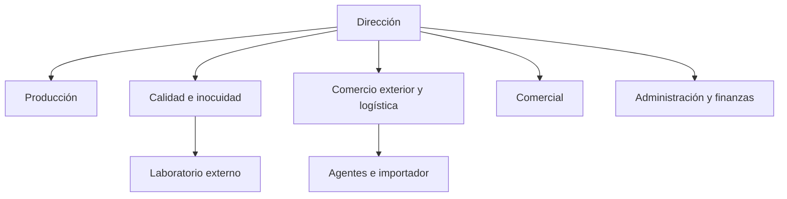

# Bendita Tortilla
## Plan de exportación para inversionistas: puntos 1 a 3.16
**Producción:** Baja California, México. **Productos:** tortilla de maíz y tortilla de harina de trigo.  
**Destino comercial definido:** Alemania. **Centro inicial:** Berlín, Moabit.  
**Zona operativa propuesta:** Berliner Großmarkt, Beusselstraße 44 N–Q, 10553 Berlín.  
**Corte de investigación:** 9 de octubre de 2026. **Versión:** revisión de inversión 2.1.

## Resumen ejecutivo

Bendita Tortilla propone exportar producto terminado elaborado en Baja California y distribuirlo inicialmente en Berlín. La operación se concentrará en **Moabit, alrededor del Berliner Großmarkt**, mediante un importador/distribuidor con servicio de congelación contratado. El complejo reúne más de 200 comerciantes y declara más de 800,000 toneladas de movimiento anual; estos datos justifican buscar infraestructura y compradores profesionales allí, sin atribuir ese movimiento al mercado de tortillas [S49]. No se ha contratado local ni capacidad de congelación.

Berlín registraba **3,913,644 residentes, de los cuales 3,728 tenían nacionalidad mexicana**, al 31 de diciembre de 2025. Esa base permite identificar una comunidad inicial; no mide compradores, hogares ni toda la población de origen mexicano [S48]. La venta recurrente a restaurantes y tiendas será el canal prioritario propuesto porque concentra pedidos; la elección deberá confirmarse con volúmenes y precios de compradores. Para las pruebas comerciales se propone el corredor de Kreuzberg 10997–10999, donde existen negocios mexicanos y oferta de nixtamal [S51–S53].

El producto inicial de desarrollo será **congelado**, con evaluación separada de seguridad, sabor, textura y comportamiento después de descongelar. La congelación es una hipótesis técnica respaldada por oferta comercial existente, no una vida útil ya acreditada de la marca [S19–S24]. No se promete sabor idéntico al recién hecho. Una fórmula estable a temperatura ambiente sigue siendo una alternativa de investigación, sin desplazar la producción mexicana.

El inicio contempla dos operaciones distintas: **hasta 60 kg de muestras técnicas**, sujetos a aceptación logística y sanitaria, y **lotes comerciales definidos por pedidos**, con una referencia base de **411 kg netos embarcados para atender una meta de 390 kg vendibles/mes** bajo una merma hipotética del 5%. La muestra es gasto de desarrollo; no prueba rentabilidad comercial. El lote mensual requiere vida útil suficiente para producción, tránsito, venta y margen de seguridad.

El precio público observado de maíz amarillo es **3.45 EUR/kg con IVA**, equivalente a **3.22 EUR/kg sin IVA**; el de harina congelada es **6.12 y 5.72 EUR/kg**, respectivamente [S22–S23]. Con márgenes internos de prueba del 25% para minorista y 20% para distribuidor, el costo máximo modelado del importador sería **1.93 EUR/kg de maíz y 3.43 EUR/kg de harina**. Es un límite de negociación calculado, no una cotización mayorista. El estrés aéreo excede ampliamente ambos límites: no se recomienda financiar reposición comercial aérea al precio de estas referencias.

La ruta marítima solo se estudiará como **carga congelada compartida aceptada por un operador**. Hapag-Lloyd publica una rotación AL4 que conecta Veracruz y Altamira con puertos europeos, incluidos Bremerhaven y Wilhelmshaven [S54]. No se presenta un contenedor exclusivo como solución para los volúmenes actuales.

La clasificación europea probable se acota a **CN 19059030 o 19059080**, según definición legal y composición. La consulta del 9 de octubre muestra, respectivamente, derechos generales de **9.7% + EA** y **9% + EA, con máximo 20.7% + AD F/M** [S46]. El componente agrícola exige composición y código adicional. El acuerdo interino firmado está publicado con calendario oficial; su preferencia no se presupone aplicable sin confirmar entrada en vigor, correlación arancelaria y origen [S47].

**Conclusión para inversión:** hay una oportunidad comercial específica y un diseño de operación, pero no hay todavía evidencia suficiente para aprobar una inversión de lanzamiento. Sí existe una base para presupuestar desarrollo y diligencia técnica. El capital comercial debe condicionarse a cuatro hitos: vida útil y sabor aprobados; acceso aduanero/sanitario resuelto; pedidos al precio necesario; y costo cotizado por debajo del techo del canal. La preferencia por Alemania es una decisión del proyecto; España y Países Bajos se conservan únicamente como comparadores y, en su caso, alternativa de entrada logística.

| Decisión | Evidencia disponible | Condición para comprometer capital |
|---|---|---|
| Alemania y centro en Berlín | Mandato del promotor; comunidad mexicana registrada [S48] | Pedidos verificables en Berlín |
| Moabit / Beusselstraße 44 N–Q | Concentración mayorista alimentaria [S49–S50] | Contrato de frío, recepción, despacho y reparto |
| Maíz y harina fabricados en Baja California | Mandato del promotor; especificaciones propuestas | Recetas, costos y capacidad medidos por SKU |
| Desarrollo congelado | Oferta competidora y bibliografía [S19–S24] | Vida útil propia y transporte validado |
| Muestras por avión; reposición compartida si viable | Infraestructura aérea y rotación marítima documentadas [S54–S56] | Aceptación, tarifa integral y temperatura garantizada |
| Lote según pedidos, referencia mensual 411 kg | Meta comercial 390 kg / 0.95 | Ventas contratadas y fecha de vencimiento compatible |

## Base de evidencia

Las referencias [S01]–[S71] enlazan las fuentes. **Observado** significa publicado por la fuente; **calculado** significa derivado de esos datos; **propuesto** identifica una decisión empresarial; **hipótesis** identifica parámetros sin medición. Ningún escenario de ventas, margen o flete se presenta como resultado de una encuesta o contrato existente. El paquete contiene tablas CSV, gráficas locales y cálculos reproducibles. Las cifras monetarias usan punto decimal para facilitar su comparación con los archivos de datos.

## Introducción

Exportar tortillas desde Baja California exige convertir la calidad de una receta en una especificación reproducible y conservarla hasta el uso final en Berlín. El plan desarrolla el potencial exportador, justifica las decisiones comerciales ya tomadas y examina mercado, regulación, distribución y economía de ambos SKU. Se concentra en decisiones de inversión y sus límites verificables; las notas de revisión se entregan aparte.

# 1. Análisis del potencial exportador

## 1.1 Perfil de la compañía

### 1.1.1 Datos básicos y reseña histórica de la compañía

| Dato | Situación de Bendita Tortilla |
|---|---|
| Nombre del proyecto | Bendita Tortilla; disponibilidad y registro de marca pendientes |
| Giro propuesto | Elaboración y comercialización de tortillas de maíz y harina de trigo |
| Ubicación obligatoria de producción | Baja California, México |
| Municipio, domicilio y planta | Por definir; no se presenta Tijuana como ubicación confirmada |
| Personalidad jurídica, RFC y fecha de constitución | No acreditados en la documentación disponible |
| Etapa documentada | Formulación de propuesta exportadora |
| Mercado de inicio | Alemania |
| Historial de ventas/exportaciones | No proporcionado |
| Certificaciones y alianzas | No proporcionadas; no se presumen |
| Información operativa pendiente | Recetas, equipos, capacidad, costos, proveedores y resultados de laboratorio |

La reseña verificable se limita al surgimiento de una propuesta para llevar tortillas mexicanas a compatriotas en Alemania, su obligación de producir en Baja California y la decisión de contemplar maíz y harina. No sería correcto inventar años de operación, una planta, socios o certificaciones para completar la historia. La organización propuesta a continuación es un diseño para la futura empresa, basado en las funciones necesarias para inocuidad y exportación [S27–S29].

### 1.1.2 Visión, misión y objetivos de la empresa

**Visión propuesta.** Consolidar una marca de tortillas elaboradas en Baja California que sea reconocida en Alemania por su sabor, calidad consistente y suministro confiable, y expandirse a otros mercados europeos cuando la operación demuestre rentabilidad.

**Misión propuesta.** Elaborar tortillas de maíz y harina en Baja California y acercarlas a consumidores y negocios en Alemania mediante procesos controlados de producción, conservación y distribución, ofreciendo información transparente sobre ingredientes, origen y uso.

**Filosofía propuesta.** Conservar la identidad gastronómica mexicana con una calidad demostrable. La innovación debe ayudar a que el producto llegue bien, sin ocultar sus condiciones de conservación ni atribuirle propiedades que no se han comprobado.

| Objetivo propuesto | Indicador y evidencia de cumplimiento |
|---|---|
| Definir los dos productos exportables | Ficha técnica y formulación aprobadas para cada SKU |
| Validar conservación y sabor | Estudio de al menos tres lotes por SKU, con criterios sanitarios definidos por especialista y aceptación sensorial preestablecida |
| Verificar acceso a Alemania | Dictamen de clasificación, revisión de etiqueta y expediente del importador |
| Validar demanda | Entrevistas, degustaciones y pedidos piloto al precio necesario, separados por producto y canal |
| Evaluar rentabilidad | Margen de contribución positivo después de merma y costos logísticos; sensibilidad documentada |
| Preparar expansión europea | Repetición de pedidos y revisión local del país adicional; no solo aprobación de una encuesta |

Los valores se traducen a controles: calidad mediante especificaciones; honestidad mediante trazabilidad; compromiso mediante entregas; tradición mediante receta definida; responsabilidad mediante inocuidad y manejo de envases. Estos son compromisos empresariales propuestos y no certificaciones.

## 1.2 Situación de la compañía

### 1.2.1 Análisis organizacional

La estructura inicial debe separar la liberación de calidad de la presión por vender. Una misma persona puede cubrir funciones administrativas en la etapa piloto, pero producción no debe liberar un lote rechazado por el responsable de inocuidad. La trazabilidad, el retiro de producto y los procedimientos de higiene sustentan esta división [S27–S29].

| Función propuesta | Responsabilidad | Evidencia que debe conservar |
|---|---|---|
| Dirección | Presupuesto, socios y decisión de avanzar | Acuerdos y evaluación de viabilidad |
| Producción | Recetas, rendimiento y planeación | Hoja de lote, consumos y tiempos |
| Calidad e inocuidad | Proveedores, muestreo, liberación y vida útil | Resultados, registros y criterios de rechazo |
| Comercio exterior y logística | Agentes, origen, transporte y documentos | Expediente de embarque y temperaturas |
| Comercial | Prospección, precios y seguimiento | Pedidos, entrevistas y recompra |
| Administración y finanzas | Costeo, facturación, cobranza y caja | Costos por SKU y flujo de efectivo |
| Apoyo externo | Laboratorio, aduanas, traducción y asesoría alimentaria | Informes y contratos de servicio |

**Organigrama funcional propuesto:**

### 1.2.2 Productos y/o servicios

Se proponen dos líneas de producto terminado. El formato inicial de ensayo es un paquete de 500 g para hogar y unidades internas de 1 kg para restauración; son propuestas por validar con compradores. El número de piezas depende del peso real y no se fija antes de medirlo. La comercialización incluirá instrucciones de conservación y calentamiento, ficha técnica y atención de incidencias.

| Especificación inicial propuesta | Maíz | Harina de trigo |
|---|---|---|
| Identidad | Tortilla de maíz; definir nixtamal de grano o harina nixtamalizada | Tortilla de harina con perfil norteño |
| Uso prioritario | Tacos y quesadillas; probar desempeño para cada uso | Tacos de harina y quesadillas; burrito requiere tamaño distinto |
| Prototipo de diámetro | 15 cm, ajustable según prueba | 20 cm, ajustable según prueba |
| Ingredientes | Receta final pendiente: tipo de maíz, agua, cal y sal si corresponde | Receta pendiente: harina, agua, grasa, sal y otros ingredientes declarados |
| Alérgenos | Evaluar ingredientes y contaminación cruzada | Trigo/gluten; revisar otros ingredientes |
| Conservación inicial a estudiar | Congelada | Congelada |
| Diferenciación que debe probarse | Aroma, flexibilidad y resistencia | Suavidad, sabor y elasticidad |

Las dimensiones no son datos de una producción existente. Se recomienda evaluar grasa vegetal y, si el equipo desea usar grasa animal, analizar antes sus consecuencias regulatorias; no se modifica unilateralmente una receta no entregada [S30].

### 1.2.3 Producto a exportar: descripción, clasificación arancelaria y arancel a pagar

Producto terminado: tortilla cocida, sin relleno, envasada; producción obligatoria en Baja California. **HS 190590** se conserva para estadística. Para despacho se identifican dos candidatos europeos, sin simular un dictamen de clasificación [S46]:

| SKU | CN de ocho dígitos candidato | Justificación y dato que decide |
|---|---|---|
| Maíz simple, sin grasa o azúcar añadidos | 19059030 si cumple la definición legal de pan; alternativamente 19059080 | 19059030 exige ausencia de miel, huevo, queso y fruta añadidos y ≤5% de azúcar y ≤5% de grasa en materia seca; la autoridad debe confirmar si la tortilla encaja |
| Harina de trigo con grasa vegetal | 19059080 si no entra en una subpartida específica | Si supera 5% de grasa en materia seca, no cumple la descripción de 19059030; porcentaje y azúcar dependen de la receta real |

**Tasa vigente consultada para México → Alemania:** 19059030: **9.70% + EA**; 19059080: **9.00% + EA MAX 20.70% + AD F/M**, como derecho general de terceros países. EA es componente agrícola y AD F/M derecho adicional sobre harina. Se explica liquidación, preferencia y calendario en 3.6–3.7. No se atribuye un código TARIC de diez dígitos definitivo: los ocho dígitos consultados no sustituyen las subdivisiones, códigos adicionales ni una información arancelaria vinculante [S32, S46, S66].

La receta aprobada, el análisis en materia seca y el expediente de origen permitirán cerrar ambos códigos, la fracción/NICO mexicana y el importe exacto antes de producir un lote comercial. La firma del acuerdo nuevo no autoriza presupuestar tasa cero.

### 1.2.4 Producción

El proceso debe ejecutarse íntegramente en Baja California. La compra de insumos extranjeros no equivale automáticamente a perder o adquirir origen preferencial: la regla aplicable se revisa por separado [S31].

| Etapa | Tortilla de maíz | Tortilla de harina | Registro propuesto |
|---|---|---|---|
| Recepción | Maíz o harina nixtamalizada, agua y auxiliares | Harina, grasa y demás ingredientes | Proveedor, lote y aceptación |
| Preparación | Nixtamalización y molienda si se usa grano; hidratación si se usa harina | Mezclado, amasado y reposo | Receta, parámetros y rendimiento |
| Formado y cocción | Espesor, diámetro y cocción definidos | División, formado y cocción definidos | Parámetros validados por SKU |
| Enfriamiento higiénico | Evitar recontaminación y condensación | Igual, con parámetros propios | Tiempo y temperatura |
| Envasado | Material apto y sello íntegro | Material apto y sello íntegro | Peso neto y prueba de cierre |
| Congelación | Proceso y temperatura interna validados | Proceso y temperatura interna validados | Curva y control de producto |
| Almacenamiento/despacho | Rotación FEFO y lote | Rotación FEFO y lote | Inventario y registro térmico |

FEFO significa despachar primero lo que vence primero. Los parámetros no se fijan a partir de una receta genérica. La NOM-251 aporta una base mexicana de higiene; su cumplimiento y otras obligaciones aplicables a la planta deberán comprobarse con la autoridad. El Reglamento 852/2004 sustenta procedimientos basados en HACCP en la cadena europea [S27, S29].

**Capacidad vendible por SKU:** kg/hora reales × horas disponibles × utilización efectiva × rendimiento conforme. Es necesario medir cuellos de botella: enfriamiento, empaque y congelación pueden limitar más que la máquina tortilladora. La capacidad de almacenamiento también debe cubrir inventario durante tránsito y venta. No se asignan toneladas mensuales sin evidencia.

**Validación de vida útil propuesta:** tres lotes independientes de cada receta; comparación fresca, refrigerada, congelada y, solo con formulación y proceso adecuados, a temperatura ambiente. El especialista definirá microorganismos, frecuencia y criterios aplicables. Se estudiarán actividad de agua, pH, integridad de sello, pérdida de humedad, textura y evaluación sensorial después de recalentamiento. Los estudios publicados orientan variables, pero no certifican una duración para Bendita Tortilla [S19–S21].

**Capacidad de referencia para el primer ciclo.** La meta comercial base exige 411 kg netos por ciclo mensual y entrega de al menos 390 kg vendibles. Se propone medir una capacidad efectiva de **500 kg/mes** para dejar margen operativo: por ejemplo, 25 kg/h conformes durante 20 horas efectivas. Es una especificación mínima de diseño, no capacidad instalada acreditada. Los 25 kg/h deberán medirse después de rechazo, envasado y congelación; no se vuelven a descontar esas pérdidas como si fueran la merma logística del 5%. Se medirá cada SKU y la ocupación de la misma línea si comparten equipo. Un congelador que solo almacena no acredita velocidad de congelación.

### 1.2.5 Recursos financieros y no financieros para la exportación

| Recurso | Uso específico | Cómo presupuestarlo |
|---|---|---|
| Desarrollo y laboratorio | Receta, etiqueta nutricional y vida útil | Cotización por SKU, lotes y puntos de muestreo |
| Equipo productivo | Cocción, enfriamiento, empaque y congelación | Capacidad medida, consumo y mantenimiento |
| Capital de trabajo | Insumos, inventario, tránsito y cobranza | Flujo semanal hasta recibir pagos |
| Logística | Transporte, aduanas, almacenaje y seguro | Cotizaciones para el mismo lote y alcance |
| Comercialización | Degustaciones, material y muestras | Costo por cliente convertido, no solo por contacto |
| Recursos no financieros | Personal, manuales, datos y acuerdos | Responsables, entregables y control documental |

La necesidad de caja incluye el tiempo durante el que el producto está inmovilizado. No se supone un crédito aprobado. Bancomext puede consultarse por financiamiento y esquemas mediante intermediarios, sujetos a elegibilidad y análisis crediticio [S38].

## 1.3 Mercadeo

### 1.3.1 Estructura de la industria

Se compite simultáneamente con tortillas especializadas de nixtamal, producción europea y tortillas/wraps industriales de trigo. No deben agruparse como sustitutos idénticos: un restaurante puede elegir según resistencia y costo por taco, mientras un hogar compara sabor y costo de envío. La existencia de proveedores especializados confirma oferta y canales; no acredita crecimiento automático de demanda [S16–S18, S22–S24].

### 1.3.2 Políticas de mercadeo y comercialización

Se propone una política de precio por SKU, canal, volumen e Incoterm; pedidos mínimos determinados por costo de entrega; información completa sobre conservación; y reclamaciones vinculadas a evidencia de lote y temperatura. No se anunciará producto “fresco” si se distribuye congelado, “orgánico” sin respaldo ni “sin gluten” por el simple hecho de contener maíz [S25–S26].

### 1.3.3 Destinos de productos, volúmenes y precios

Alemania es el destino definido y Berlín el centro. El lote comercial se dimensiona con pedidos aceptados; las muestras técnicas se presupuestan por separado. España y Países Bajos se utilizan como comparadores. No hay volumen real de ventas ni precio aprobado. Se propone evaluar por separado maíz y harina y determinar el precio desde costos y disposición a pagar. Los escenarios de 3.4 y 3.10 son ejercicios, no pronósticos.

### 1.3.4 Canales de distribución

El canal inicial propuesto es fabricante en Baja California → importador/distribuidor especializado → restaurantes y tiendas → consumidor. Se reduce el número de entregas pequeñas y se asigna claramente almacenamiento y obligaciones de importación. Venta directa en línea se condiciona a una última milla validada; un transportista de paquetería ordinaria no garantiza cadena de frío [S22, S34–S35].

### 1.3.5 Principales clientes

No se acreditan clientes actuales. Los compradores prioritarios propuestos son restaurantes mexicanos de Berlín, tiendas con congelador y un importador/distribuidor que pueda recibir y repartir ambos SKU. En 3.15 se identifican organizaciones reales para prospección, con fuente y finalidad; figurar allí no implica interés ni acuerdo comercial.

### 1.3.6 Expectativas de los clientes

Hipótesis por medir: sabor familiar, tortillas que se separen sin romperse, calentamiento sencillo, precio accesible, conservación clara y disponibilidad. Para restaurantes se agregarán costo por pieza utilizable, uniformidad, mínimos de pedido y puntualidad. Ninguna expectativa se atribuye a “todos los alemanes”; se comprobará mediante entrevistas y degustaciones.

### 1.3.7 Percepción del cliente sobre el producto

No se dispone de una medición de percepción de Bendita Tortilla. Se propone comparar a ciegas los dos SKU con referencias de mercado, registrar sabor y textura antes de mostrar la marca, y después medir si origen y presentación cambian la preferencia. Esto separa aceptación del producto de afinidad por México. La relevancia de medir atributos sensoriales se apoya en estudios de tortillas [S19–S21].

### 1.3.8 Estrategias de promoción

Se proponen degustaciones con compradores, recetas en español/alemán, instrucciones de recalentamiento y contenido sobre producción real en Baja California. El reclutamiento en foros se hará como investigación identificada y autorizada, no como publicidad encubierta. El gasto promocional se evaluará por pedidos y recompra. El protocolo completo está en 3.12.2.

## 1.4 Competitividad

### 1.4.1 Análisis de la competencia

| Referencia | Evidencia pública | Implicación para Bendita Tortilla |
|---|---|---|
| Tlaxcalli, Alemania | Producción desde 2016 y maíz propio en Rothenklempenow | El origen mexicano debe competir con cercanía y relato agrícola local [S16] |
| La Tortilla, Alemania | Molienda de nixtamal cerca de Múnich | “Nixtamalizada” no constituye exclusividad [S17] |
| Moctezuma Foods, Chequia/mercado alemán | Producción en Praga y oferta HORECA | Hay proveedores europeos especializados con formatos profesionales [S18] |
| Mex-Al, Alemania | Maíz y harina congelados, además de trigo ambiente | Se compite en precio, formato, frío y servicio [S22–S24] |

### 1.4.2 Posición frente a la competencia

Bendita Tortilla tiene una marca en desarrollo y una restricción de fabricación a larga distancia. Aún no posee una ventaja comprobada de precio o calidad. Su posición inicial sería de especialidad, con prioridad a compradores que distingan el producto y acepten pagar el costo necesario. El diferencial se cuantificará mediante preferencia ciega, roturas, costo por porción y recompra. No se propone competir inicialmente por precio con toda la oferta industrial.

### 1.4.3 Ventajas comparativas

Elaborar en México ofrece un origen verificable y una relación directa con la identidad de la propuesta. Baja California puede aportar un perfil norteño a la harina, como posicionamiento por probar. Estas ventajas narrativas deben convertirse en valor percibido. No se afirma ventaja salarial, agrícola o logística sin comparar costos. La distancia es una desventaja operativa que debe compensarse con producto y servicio.

## 1.5 Evaluación global y conclusiones

### 1.5.1 Análisis FODA

| Fortalezas potenciales del diseño | Debilidades actuales |
|---|---|
| Origen de producción definido; dos productos complementarios; identidad de marca mexicana | Sin receta final, capacidad, costo, vida útil ni clientes acreditados; distancia al destino |
| Oportunidades observadas o por validar | Amenazas |
| Canales especializados existentes; posible demanda de sabor familiar; ventas agrupadas a restauración | Producción europea; presión de precios; merma y retrasos; requisitos por ingredientes; falta de volumen para frío rentable |

El FODA es una síntesis analítica del proyecto y de la oferta verificada, no el resultado de un estudio de consumidores [S16–S24, S30, S34–S35].

### 1.5.2 Percepción de barreras

Las barreras prioritarias son conservar calidad, pagar la cadena de frío, obtener margen y cumplir requisitos alimentarios. La comercialización europea añade idioma, expediente del importador y manejo de envases. Una eventual receta con manteca, leche o huevo exige revisar el régimen sanitario antes de prometer exportabilidad [S25, S30, S36–S37].

### 1.5.3 Conocimiento de mercados internacionales

El equipo dispone de una base documental inicial, pero todavía debe convertirla en evidencia operativa: contactos calificados, cotizaciones, dictamen de origen y pruebas de producto. Conocer indicadores macroeconómicos no equivale a conocer los términos de compra de un distribuidor. Se propone mantener un expediente actualizado por SKU y por país.

### 1.5.4 Evaluación y comentario del potencial exportador

**Resultado: potencial exportador condicionado.** Puede avanzarse a desarrollo de producto y validación comercial; no hay evidencia para aprobar exportación regular. El proyecto debe detener o reformular un SKU si no consigue seguridad, aceptación sensorial y margen simultáneamente. Es posible que un producto funcione antes que el otro: ambas líneas siguen en el proyecto, pero no se fuerza un lanzamiento conjunto con desempeño desigual.

# 2. Selección de mercados

## 2.1 Preselección de mercados: países de interés

**Alemania es el destino definido por el promotor.** La decisión responde al propósito de atender a compatriotas allí; la investigación comprueba condiciones para ejecutar esa decisión. España y Países Bajos no son destinos alternos aprobados: se mantienen como comparadores de escala, vínculo importador con México e ingreso. Países Bajos puede evaluarse como entrada logística sin cambiar el destino comercial.

## 2.2 Priorización de mercados: criterios de selección

Se ejecuta la comparación con tres criterios medibles. Se retiran los pesos 30/25/20/15/10 porque no tenían fundamento empírico ni mandato del inversionista. Cada indicador se normaliza como **100 × valor del país / máximo observado entre los tres**. No se agrega una puntuación total: sumar indicadores sin una preferencia de riesgo acordada generaría una precisión ficticia.

| País | Importaciones HS190590 2024, MUSD | Desde México 2024, miles USD | PIBpc 2025, USD | Índice escala | Índice vínculo MX | Índice ingreso |
|---|---|---|---|---|---|---|
| Alemania | 2,579.41 | 75.58 | 60,496.44 | 100.00 | 10.42 | 82.10 |
| España | 692.71 | 725.52 | 38,627.25 | 26.86 | 100.00 | 52.42 |
| Países Bajos | 1,486.31 | 641.41 | 73,683.92 | 57.62 | 88.41 | 100.00 |

Fuentes: WITS [S10–S13] y WDI [S01]. HS190590 es un agregado de panadería; definición y límites en 3.4. Alemania tiene la mayor escala importadora de los comparadores, pero el menor vínculo observado con México; Países Bajos tiene mayor ingreso por habitante. Estos resultados justifican investigar competencia y canal alemán, sin afirmar superioridad automática de Alemania ni utilizar los índices como demanda de tortillas.

## 2.3 Selección final de mercados

**Destino: Alemania. Ciudad central: Berlín. Zona operativa: Moabit, Beusselstraße 44 N–Q, 10553, entorno del Berliner Großmarkt.** El lugar se selecciona por concentración de infraestructura y comercio alimentario. La empresa operará inicialmente mediante un socio establecido y no mediante la compra de un inmueble o la apertura de una cámara propia.

| Alternativa en Berlín | Evidencia verificable | Uso y decisión |
|---|---|---|
| Moabit: Berliner Großmarkt | >330,000 m², >200 comerciantes y >800,000 t/año publicados por el operador; atención a gastronomía y catering [S49] | Centro de recepción/distribución propuesto; confirmar servicio congelado y precio |
| Kreuzberg: Eisenbahnstraße–Skalitzer Straße–Wiener Straße, 10997–10999 | Markthalle Neun, Ta'Cabrón y Chaparro; tortillas y gastronomía mexicana documentadas [S51–S53] | Área de entrevistas, degustación y primeras cuentas; no cámara central acreditada |

El directorio del complejo registra a **Wittenbeck Großhandel, Halle 29A**, con oferta de productos congelados [S50]. Es un candidato concreto para consulta, no un servicio 3PL ni una relación ya confirmados. Si ningún socio en el complejo garantiza temperatura y condiciones económicas, se buscará un almacén externo que sirva Moabit; no se improvisará frío para mantener una dirección.

No hay datos verificados de nacionalidad mexicana por barrio que permitan afirmar que Moabit concentre esa comunidad. El fundamento del centro es logístico, mientras que el acceso al consumidor se validará comercialmente. Se prohíbe convertir la población del barrio en previsión de ventas.

# 3. Inteligencia de mercados

## 3.1 Perfil del país objetivo y comparadores

Alemania utiliza el euro, tiene estructura federal y exige información alimentaria comprensible para su mercado; se propone alemán principal en etiqueta y español complementario [S02, S25]. Berlín será el centro comercial y Moabit el punto operativo propuesto. El despacho puede efectuarse en Fráncfort para muestras o en un puerto alemán en una reposición marítima, sujeto a contratación [S54–S56].

| Base territorial, residentes inscritos al 31-12-2025 | Valor | Alcance |
|---|---:|---|
| Berlín | 3,913,644 | Registro de residentes; no mezclar con población censal/estimada de otra base |
| Nacionalidad mexicana en Berlín | 3,728 | Personas; excluye naturalizados que ya no figuren con esa nacionalidad |
| Distrito Mitte | 397,879 | Distrito que contiene Moabit |
| Ortsteil Moabit | 84,913 | Barrio administrativo; no equivale a población del código postal 10553 |
| Friedrichshain-Kreuzberg | 292,789 | Distrito comercial de pruebas; no se atribuye toda esta población al corredor |

Fuente: Amt für Statistik Berlin-Brandenburg, informe A I 5 – hj 2/25, febrero de 2026, tablas 1, 7, 10 y 11 [S48]. Los tres niveles territoriales se identifican para evitar dobles conteos. La nacionalidad mexicana representa aproximadamente **0.0953%** de los residentes registrados de Berlín; no indica frecuencia de compra.

España y Países Bajos se describen mediante las series comparables de 3.2, exclusivamente para contraste. Róterdam se conserva como opción logística si un operador presenta una propuesta integral más favorable; requerirá asignar importador, despacho y traslado a Alemania [S03–S04, S33, S40].

## 3.2 Análisis del entorno comercial e indicadores económicos

**Base estadística.** Las tablas siguientes utilizan World Development Indicators (WDI), consultado por API el 9 de octubre de 2026, para 2021–2025. Se conservan sus valores y revisión sin mezclarlos con boletines nacionales. PIB por habitante e intercambio se expresan en USD corrientes; inflación corresponde al indicador de precios al consumidor, no al índice armonizado europeo; desempleo corresponde a estimación modelada OIT. Población usa la definición de WDI, no necesariamente el conteo nacional al 31 de diciembre. Datos 2025 pueden revisarse [S01].

### Serie de Alemania, 2021–2025

| Indicador | 2021 | 2022 | 2023 | 2024 | 2025 |
|---|---:|---:|---:|---:|---:|
| PIB real, variación anual (%) | 3.91 | 1.81 | -0.87 | -0.50 | 0.24 |
| PIB por habitante (USD corrientes) | 52,349.25 | 50,506.52 | 54,776.77 | 56,103.73 | 60,496.44 |
| Población (millones) | 83.20 | 83.18 | 83.29 | 83.52 | 83.49 |
| Inflación IPC (%) | 3.07 | 6.87 | 5.95 | 2.26 | 2.17 |
| Desempleo, estimación OIT (%) | 3.59 | 3.14 | 3.07 | 3.40 | 3.71 |
| Importaciones bienes y servicios (miles de millones USD) | 1,628.85 | 1,813.05 | 1,779.05 | 1,764.44 | 1,923.29 |
| Exportaciones bienes y servicios (miles de millones USD) | 1,851.85 | 1,916.86 | 1,960.26 | 1,941.43 | 2,042.33 |

Fuente: WDI [S01]; cálculo y redondeo propios.

### Serie de España, 2021–2025

| Indicador | 2021 | 2022 | 2023 | 2024 | 2025 |
|---|---:|---:|---:|---:|---:|
| PIB real, variación anual (%) | 6.68 | 6.37 | 2.46 | 3.46 | 2.82 |
| PIB por habitante (USD corrientes) | 30,799.48 | 30,319.50 | 33,493.22 | 35,326.77 | 38,627.25 |
| Población (millones) | 47.44 | 47.79 | 48.35 | 48.85 | 49.36 |
| Inflación IPC (%) | 3.09 | 8.39 | 3.53 | 2.77 | 2.67 |
| Desempleo, estimación OIT (%) | 14.91 | 13.03 | 12.18 | 11.40 | 10.38 |
| Importaciones bienes y servicios (miles de millones USD) | 478.81 | 562.07 | 550.32 | 567.65 | 625.57 |
| Exportaciones bienes y servicios (miles de millones USD) | 493.27 | 574.78 | 612.43 | 639.46 | 698.48 |

Fuente: WDI [S01]; cálculo y redondeo propios.

### Serie de Países Bajos, 2021–2025

| Indicador | 2021 | 2022 | 2023 | 2024 | 2025 |
|---|---:|---:|---:|---:|---:|
| PIB real, variación anual (%) | 6.28 | 5.01 | -0.60 | 1.07 | 1.78 |
| PIB por habitante (USD corrientes) | 60,141.99 | 59,123.32 | 63,515.60 | 67,465.32 | 73,683.92 |
| Población (millones) | 17.53 | 17.70 | 17.88 | 17.99 | 18.09 |
| Inflación IPC (%) | 2.68 | 10.00 | 3.84 | 3.35 | 3.20 |
| Desempleo, estimación OIT (%) | 4.21 | 3.53 | 3.54 | 3.70 | 3.87 |
| Importaciones bienes y servicios (miles de millones USD) | 808.83 | 917.44 | 880.50 | 867.46 | 925.62 |
| Exportaciones bienes y servicios (miles de millones USD) | 911.59 | 1,009.32 | 993.38 | 1,001.47 | 1,075.13 |

Fuente: WDI [S01]; cálculo y redondeo propios.

**Figura 1.** Variación anual real del PIB (%). Fuente: WDI, NY.GDP.MKTP.KD.ZG [S01]. Alemania muestra estancamiento/contracción en 2023–2024 y un crecimiento limitado en 2025 en esta serie. España presenta mayor crecimiento reciente. Esto sugiere prudencia en proyecciones, pero no mide compra de tortillas.

**Figura 2.** Variación anual del IPC (%). Fuente: WDI, FP.CPI.TOTL.ZG [S01]. La desaceleración desde 2022 no significa que los precios hayan regresado a niveles previos; significa que aumentaron a menor ritmo. Por ello, se medirán precios totales y sensibilidad al gasto.

**Actualizaciones y diferencias de revisión.** El INE español publica para 2025 un crecimiento revisado de 2.6% y para 2024 de 3.7%, frente a 2.82% y 3.46% de la extracción WDI. CBS publica 1.8% de crecimiento neerlandés en 2025 y 3.3% de inflación, frente a 1.78% y 3.20% WDI. Destatis informa 2.2% de inflación media alemana en 2025. Las diferencias no se promedian: se identifican como distintas revisiones/fuentes. Para una decisión nacional reciente se toma en cuenta el instituto nacional, manteniendo WDI como comparación reproducible [S05–S08].

**Coyuntura 2026.** Destatis publicó una estimación preliminar de inflación alemana interanual de 3.3% en septiembre de 2026. Es un dato mensual preliminar, no inflación media anual. Refuerza incluir sensibilidad de energía, flete y precios en el piloto. No se presenta un resultado anual 2026 aún inexistente [S09].

**Tipo de cambio.** Se propone vender en EUR y controlar costos mexicanos en MXN, identificando fletes cotizados en USD. No se utiliza la antigua serie EUR/USD de la documentación disponible para convertir costos actuales. La cotización deberá registrar fecha, vigencia y tipo de cambio; el modelo comparará movimientos de ±10% como prueba de sensibilidad, no como pronóstico.

## 3.3 Identificación de oportunidades y amenazas del mercado

| Oportunidad o restricción | Dato que la sustenta | Decisión y prueba |
|---|---|---|
| Comunidad inicial identificable | 3,728 residentes de nacionalidad mexicana en Berlín [S48] | Reclutamiento en español; medir consumo y no asumir compra por nacionalidad |
| Canal profesional concentrado | Ecosistema mayorista en Moabit [S49–S50] | Buscar un socio de frío y entregas agrupadas antes de asumir costos fijos de almacén propio |
| Oferta mexicana local | Tlaxcalli, La Tortilla y oferta en Markthalle Neun [S16–S17, S51] | Comparación ciega de sabor y desempeño, no promesa de mercado desatendido |
| Brecha de costo maíz | Retail neto 3.22 EUR/kg; techo modelado 1.93 [S22] | Cotizar contra ese presupuesto; probar prima de precio mediante pedido |
| Riesgo de calidad en tránsito | Cambios de textura estudiados por receta [S19–S21] | Validar ambos SKU y sistema completo de congelación/transporte |

Cada embarque comercial deberá respaldarse con pedidos por SKU y condiciones de entrega. Las degustaciones y respuestas en foros son evidencia exploratoria; no autorizan un lote de inventario ni sustituyen una recompra.

## 3.4 Análisis del sector de tortillas y productos relacionados

### Comercio sectorial observado y límites de interpretación

HS 190590 incluye otros productos de panadería y artículos relacionados; **no corresponde exclusivamente a tortillas**. WITS presenta estas páginas en nomenclatura HS 1988/92 (H0). Se utiliza el mismo agregado para comparar años y países, sin equipararlo al código aduanero final de Bendita Tortilla. Importaciones incluyen intercambio intracomunitario; no todo se importa desde fuera de la UE [S10–S15].

| Alemania: HS 190590 | Importaciones, millones USD | Exportaciones, millones USD | Saldo X−M, millones USD | Cantidad importada, millones kg |
|---|---:|---:|---:|---:|
| 2020 | 1,751.68 | 2,914.90 | 1,163.22 | 642.24 |
| 2021 | 2,027.82 | 3,103.47 | 1,075.65 | 706.00 |
| 2022 | 2,155.63 | 3,315.03 | 1,159.40 | 749.84 |
| 2023 | 2,672.99 | 3,836.80 | 1,163.81 | 805.01 |
| 2024 | 2,579.41 | 3,690.37 | 1,110.96 | 811.72 |

Fuentes: WITS/UN Comtrade, páginas anuales de Alemania [S10–S11]. El saldo 2022 se calcula con las cifras mostradas: 3,315.03 − 2,155.63 = 1,159.40; con los valores sin redondear resulta 1,159.40575. La serie sectorial 2020–2024 complementa los perfiles macro 2021–2025; no se inventa 2025 para el sector. El agregado pasó de USD 1,751.68 a 2,579.41 millones: crecimiento nominal acumulado de aproximadamente 47.25% y CAGR de 10.16% en cuatro intervalos. La cantidad importada creció aproximadamente 26.39%, CAGR de 6.03%. En 2024 el valor cayó aproximadamente 3.50% y el volumen aumentó 0.83%. **Ninguna de estas tasas es crecimiento de ventas de tortillas.**

**Figura 3.** Comercio del agregado amplio, USD corrientes, 2020–2024 [S10–S11]. Alemania es exportador neto de esa categoría en todos los años mostrados; la presencia de industria local es relevante al evaluar competencia. Sin producción específica y existencias no puede calcularse consumo aparente de tortillas.

| Comparación sectorial 2024 | Alemania | España | Países Bajos |
|---|---:|---:|---:|
| Importaciones HS 190590, millones USD | 2,579.41 | 692.71 | 1,486.31 |
| Exportaciones HS 190590, millones USD | 3,690.37 | 1,594.45 | 1,583.63 |
| Saldo exportador, millones USD | 1,110.96 | 901.74 | 97.32 |
| Cantidad importada, millones kg | 811.72 | 229.89 | 657.68 |
| Importaciones desde México, miles USD | 75.58 | 725.52 | 641.41 |
| Cantidad desde México, kg | 7,850 | 462,325 | 180,339 |

Fuentes: Alemania [S10–S11], España [S12], Países Bajos [S13]. No se infiere que estos flujos sean solo tortillas; tampoco se utiliza valor/masa promedio como precio de venta del producto. España y Países Bajos muestran vínculos de la categoría con México, pero eso no acredita aceptación de la marca.

### Dimensionamiento de demanda alcanzable

No existe en la evidencia obtenida una medición oficial que separe demanda alemana de tortillas de maíz y harina. La base demográfica concreta es la de 3.1; el dimensionamiento comercial utiliza cuentas y compras, evitando contar los mismos kg como venta a tienda y venta al hogar.

| Cartera mensual hipotética | Conservador | Base | Expansión |
|---|---:|---:|---:|
| Hogares de compra directa × kg/mes | 50 × 1 | 100 × 1 | 200 × 1 |
| Restaurantes × kg/mes | 3 × 30 | 5 × 40 | 10 × 50 |
| Tiendas × kg/mes | 2 × 20 | 3 × 30 | 5 × 40 |
| **Meta total vendible, kg/mes** | **180** | **390** | **900** |
| Kg netos a embarcar, merma supuesta 5% | 190 | 411 | 948 |
| Cobertura vendible de lote anterior de 1,000 kg | 158.3 días | 73.1 días | 31.7 días |

Las metas son cartera necesaria, **no pronóstico ni pedidos existentes**. El lote se calcula con **Q = redondeo superior[D/(1−merma)]**; mezcla y destinos se toman de pedidos, sin imponer 50/50. La referencia base de 411 kg entrega 390.45 kg, cubriendo 30.03 días a esa velocidad de venta. Se programará la reposición según plazo real, seguridad y fechas, manteniendo visible el inventario de tránsito además del de Berlín.

En el inicio se priorizará B2B: si no hay venta directa autorizada, el componente de hogares no se incluye en pedidos comprometidos. Sin esos 100 kg, la base sería 290 kg/mes y un lote calculado de 306 kg, no 411. Las tres carteras tampoco demuestran cuántos restaurantes alcanzarán los consumos supuestos.

**Regla de embarque:** 100% del lote comercial asignado a pedidos aceptados por SKU, revisando cancelación, solvencia y fecha de entrega. Los contratos determinarán el anticipo; no se declara ya cobrado. La reducción del lote corrige inmovilización, pero un lote pequeño puede encarecer el flete: si no existe una carga compartida rentable, se pospone la exportación comercial en lugar de llenar un contenedor con inventario especulativo.

## 3.5 Comercio bilateral

| Importaciones alemanas desde México, HS 190590 | Valor, miles USD | Masa, kg |
|---|---:|---:|
| 2020 | 30.82 | 7,674 |
| 2021 | 16.88 | 4,658 |
| 2022 | 49.11 | 6,436 |
| 2023 | 1,771.21 | 113,671 |
| 2024 | 75.58 | 7,850 |

Fuente: reporte del importador Alemania en WITS [S10]. El salto de 2023 y la caída de 2024 impiden suponer una tendencia estable. Es necesario contrastar con exportaciones mexicanas espejo y categorías más finas antes de atribuir el cambio a consumo, precios o tortillas. En 2024 México representó aproximadamente 0.00293% del valor importado alemán del agregado. Una participación pequeña no prueba demanda insatisfecha; puede reflejar abastecimiento europeo, composición de productos o registro comercial.

**Figura 4.** Miles de USD, 2020–2024 [S10]. La anomalía de 2023 debe investigarse; no se extrapola. Como contexto adicional, el Consejo de la UE reporta cerca de EUR 87 mil millones de comercio de bienes UE–México en 2025. Es el conjunto de la UE y todos los bienes, **no comercio bilateral Alemania–México ni tortillas** [S15].

## 3.6 Acuerdos comerciales

El Acuerdo Global Modernizado y el acuerdo comercial interino UE–México se firmaron el 22 de mayo de 2026; el Consejo aprobó la conclusión del interino el 14 de julio. El texto firmado está publicado en el Diario Oficial de la UE, **L 2026/1528, de 31 de julio de 2026** [S15, S47]. La firma y la conclusión europea no equivalen por sí solas a aplicación preferencial.

El artículo 33.9.2 del interino establece entrada en vigor **el primer día del segundo mes siguiente a la notificación mutua de terminación de procedimientos internos**. Al corte de consulta no se obtuvo confirmación oficial inequívoca de la fecha efectiva; EUR-Lex identifica entrada pendiente o no determinada. Tampoco se acredita aquí aprobación del Senado mexicano. El modelo no anticipa preferencias del tratado nuevo: deben verificarse fecha, origen y medida aduanera al despacho [S47].

**Se consultó el calendario oficial, no una declaración periodística.** El anexo 2-A utiliza **CN 2016**, de modo que sus códigos deben correlacionarse con la nomenclatura actual [S47, apéndice 2-A-1]:

| Línea del anexo CN2016 | Descripción relevante | Tasa base del anexo | Categoría | Efecto condicionado a entrada en vigor y origen |
|---|---|---|---|---|
| 19059030 | Pan con límites de composición descritos en 1.2.3 | 9.7% + EA | 0 | Eliminación a la entrada en vigor |
| 19059090 | Otros | 9% + EA MAX 20.7% + AD F/M | 3 | Tres etapas anuales; libre el 1 de enero del año 3 |
| 19059060 | Con edulcorante añadido | 9% + EA MAX 24.2% + AD S/Z | 5 | Cinco etapas; no se supone aplicable a receta sin aprobar |

Localización en texto firmado: anexo 2-A, reglas generales, pp. **251–252/975**; líneas de productos, pp. **308–309/975**. Verificar paginación del lector antes de citar; el paquete contiene una extracción localizada con las líneas. Año 1 comienza a la entrada y termina el 31 de diciembre; las reducciones siguientes ocurren el 1 de enero. Categoría 3 no significa necesariamente 36 meses de espera. **No se adjudica automáticamente el calendario del antiguo 19059090 al actual 19059080**: el agente deberá documentar la correlación.

La producción en Baja California no acredita por sí sola origen preferencial: se revisan insumos, regla específica, transformación y prueba del acuerdo realmente aplicable. El acuerdo histórico sigue siendo la referencia cuando corresponda hasta que se confirme aplicación del nuevo. No se utilizan indistintamente sus pruebas de origen [S31, S47].

## 3.7 Tratamiento arancelario

**Resultado verificable de la consulta:** Access2Markets, origen MX, destino DE, CN19059030 y CN19059080, actualización arancelaria indicada **09-10-2026** [S46].

| Candidato | Derecho general mostrado | Qué falta para liquidar |
|---|---|---|
| 19059030 | 9.70% + EA | Confirmar clasificación, código adicional de composición y preferencia aplicable |
| 19059080 | 9.00% + EA MAX 20.70% + AD F/M | Confirmar clasificación, Meursing, componente sobre harina y preferencia |
| IVA alimentario observado en consulta | 7% | Confirmar producto, base, despacho y derecho de deducción del importador |

Estos son derechos generales observados; la pantalla consultada no respalda adjudicar tasa preferencial cero a las recetas. La tasa ad valorem ya no queda totalmente pendiente; el componente y liquidación final sí requieren receta. La autoridad puede resolver clasificación mediante información vinculante [S32, S66].

Para CN19059080, la notación MAX significa que el derecho de 9% más EA no puede exceder 20.7% más el adicional AD F/M [S67]. El modelo aplica:

**Derecho = mínimo(0.09 × V + EA × Q/100; 0.207 × V + AD F/M × Q/100)**,

con V = valor en aduana en EUR, Q = kg netos y componentes específicos en EUR/100 kg. Para CN19059030 se utilizaría **0.097 × V + EA × Q/100**. La ficha de composición y la nomenclatura deberán determinar si esa unidad/código adicional son los del producto real.

Los derechos escalan con valor y masa; no se asignan 300 EUR constantes a cualquier lote. El valor en aduana parte de la transacción, con ajustes de transporte/seguro hasta entrada UE, no simplemente del costo de fabricación. El IVA se mantiene en caja y, cuando sea deducible, se excluye del costo económico; no se presume recuperable para un operador sin situación fiscal confirmada [S46, S65].

## 3.8 Requisitos

### 3.8.1 Requisitos para entrar al mercado

| Materia | Aplicación a Bendita Tortilla | Evidencia/revisión |
|---|---|---|
| Seguridad y trazabilidad | Identificar insumos, lotes, compradores y procedimiento de retiro | Reglamento 178/2002 [S28] |
| Higiene y HACCP | Procedimientos y controles basados en peligros | Reglamento 852/2004 y base mexicana NOM-251 [S27, S29] |
| Aditivos | Verificar autorización para la categoría y dosis del producto final | Reglamento 1333/2008/base de aditivos [S41] |
| Contaminantes | Evaluar micotoxinas y demás peligros pertinentes de cereales | Reglamento 2023/915, versión vigente [S42] |
| Control de importación | Confirmar si combinación producto/origen tiene controles reforzados | Reglamento 2019/1793 y listas actuales [S43] |
| Ingredientes animales | Revisar manteca, leche, huevo y otros ingredientes | Reglas de productos compuestos [S30] |
| Información alimentaria | Etiqueta y ficha coherentes con receta | Reglamento 1169/2011 [S25] |
| Envase alimentario | Aptitud, migración y cumplimiento documental | Marco 1935/2004 y reglas para plásticos [S36] |

No se exige automáticamente TRACES o un certificado veterinario a toda tortilla. Una formulación exclusivamente vegetal y otra con productos animales pueden tener obligaciones diferentes. La clasificación sanitaria es independiente de la clasificación arancelaria. Se revisa receta, origen, tratamiento y estabilidad con el importador y autoridad [S30, S43].

**Decisión relevante para harina:** si se utiliza manteca u otro ingrediente animal, su procedencia y tratamiento pueden condicionar el acceso. Evaluar grasa vegetal es una alternativa de desarrollo, no una promesa de que cualquier sustitución elimina toda obligación. No se declara halal, vegano u orgánico sin verificar formulación y requisitos.

### Controles específicos de maíz, panificación y vida útil

| Materia | Aplicación al proyecto | Decisión respaldada |
|---|---|---|
| OGM: Reglamentos 1829/2003 y 1830/2003 | Autorización, trazabilidad y etiquetado de maíz e ingredientes derivados | Solicitar identidad y declaración por lote; comprobar eventos autorizados y documentación. Proponer cadena no OGM verificable, sin declarar ya certificado [S57–S58] |
| Umbral OGM 0.9% | Exención de etiquetado para presencia accidental o técnicamente inevitable de material autorizado, sujeta a requisitos | No es permiso general para OGM no autorizados ni exención de adición intencional; no confundir con ausencia absoluta [S57–S58] |
| Acrilamida, Reglamento 2017/2158 | Incluye pan y determinadas categorías de panificación; tortilla no se enumera por nombre | Determinar categoría con especialista; documentar cocción y evaluar exposición. Los niveles de referencia son de evaluación/mitigación, no límites máximos genéricos para tortilla [S59] |
| Microbiología, Reglamento 2073/2005 | Criterios según categoría, condición de listo para consumo y capacidad de crecimiento | Evaluar pH, actividad de agua, proceso, ambiente y vida después de descongelar; congelación no elimina contaminación [S60] |
| Cambio Listeria, Reglamento 2024/2895 | Aplicable desde 01-07-2026 a categorías pertinentes de alimentos listos para consumo | Incorporar regla actual y estudio de vida útil; no asumir que recalentar por sabor excluye automáticamente la condición de listo para consumo [S61] |

El laboratorio deberá justificar microorganismos y criterios por SKU. No se copia un límite de una categoría distinta. Cuando corresponda a alimento listo para consumo que favorece crecimiento de Listeria y no se demuestra cumplimiento del umbral durante la vida útil, la modificación de 2026 exige el criterio de no detección en 25 g durante su comercialización [S60–S61]. Una instrucción de cocción solo cambia la evaluación si es un paso de seguridad definido y validado. Maíz y harina compartirán controles de contaminación cruzada; declaración sin gluten requiere evidencia específica.

### 3.8.2 Licencias

No se identifica una “licencia europea universal de tortilla”. Hay registros y autorizaciones cuya necesidad depende de la actividad y la receta. Deben verificarse: formalización mexicana, RFC y obligaciones de planta; identificación EORI del operador que actúe en aduana; registro del negocio alimentario europeo ante autoridad competente; y requisitos específicos si el producto queda sujeto a controles especiales [S27, S29–S32, S40, S43].

Certificados privados solicitados por cadenas, como esquemas reconocidos por compradores, no se confunden con licencias públicas. Ninguno está acreditado para Bendita Tortilla. La consulta de certificados COFEPRIS, cuando los solicite el destino o comprador, debe hacerse para la modalidad correcta; su existencia no sustituye el cumplimiento europeo.

### 3.8.3 Documentación requerida para la entrada del producto

| Documento/registro | Emisor o responsable propuesto | Condición |
|---|---|---|
| Factura comercial y CFDI/complemento aplicable | Exportador | Según operación y disposiciones SAT [S44] |
| Pedimento y expediente de exportación | Exportador/agente mexicano | Clasificación y régimen correctos |
| Lista de empaque | Exportador | Kg netos/brutos, cajas, lotes y dimensiones |
| Documento de transporte | Transportista | B/L marítimo, AWB aéreo; documento terrestre correspondiente |
| Declaración de importación/EORI | Importador/agente europeo | Según despacho y país de entrada [S32] |
| Prueba de origen | Conforme al acuerdo aplicable | Solo si se reclama preferencia [S31] |
| Ficha y etiqueta | Fabricante e importador | Receta, nutrición, conservación y operador responsable [S25] |
| Resultados de laboratorio y vida útil | Laboratorio/fabricante | Respaldo técnico; no todos son certificados obligatorios de frontera |
| Certificados sanitarios/CHED/TRACES | Responsable y autoridad que corresponda | Únicamente cuando el régimen aplicable lo exija [S30, S43] |
| Declaraciones/documentación de envase | Proveedor y operador responsable | Aptitud alimentaria y obligaciones aplicables [S36–S37] |
| Seguro, registros térmicos y entrega | Asegurador/logística | Cobertura, continuidad de frío y recepción |

Los originales, versiones y traducciones deben coincidir en descripción, masas, lote y destinatario. Para las muestras se revisará el procedimiento comercial y sanitario correspondiente; no se presume exención por ser gratuitas.

### 3.8.4 Etiquetado y empaque

La etiqueta se diseñará para el mercado de destino con revisión profesional. Para Alemania se propone alemán como idioma principal y español complementario. Se deberá incluir, según aplicabilidad, denominación del alimento, ingredientes, alérgenos destacados, cantidad neta, fecha, conservación, instrucciones, operador responsable en la UE, origen cuando corresponda y declaración nutricional. Los valores nutricionales se obtendrán de una base técnicamente válida para la receta; no se copian los de una marca competidora [S25].

| Elemento específico | Maíz | Harina |
|---|---|---|
| Denominación descriptiva propuesta | Tortillas de maíz congeladas / Maistortillas, tiefgefroren | Tortillas de trigo congeladas / Weizentortillas, tiefgefroren |
| Alérgenos | Determinar ingredientes y riesgo de contaminación cruzada | Destacar trigo; evaluar otros ingredientes |
| Declaración sin gluten | Solo con control y demostración del límite aplicable | No corresponde a tortilla convencional de trigo |
| Descongelación y consumo | Instrucciones propias validadas | Instrucciones propias validadas |
| Lote y peso | Correspondencia con producción | Correspondencia con producción |

“Sin gluten” exige que el producto vendido no supere 20 mg/kg de gluten; elaborar harina y maíz en la misma planta obliga a gestionar el riesgo antes de usar esa declaración [S26].

**Envase primario propuesto:** bolsa apta para congelación y contacto alimentario, con barrera y resistencia verificadas; no se determina polímero ni espesor sin ensayo. **Secundario:** caja resistente a humedad y compresión, con lote y manejo. **Terciario:** paletizado estable compatible con transporte y almacén. Pedir declaración de conformidad cuando aplique y pruebas pertinentes de migración [S36].

Alemania requiere asignar quién introduce legalmente los envases y cumple LUCID, participación en sistema y reportes cuando correspondan. Además, el Reglamento (UE) 2025/40 tiene aplicación general desde el 12 de agosto de 2026, con obligaciones de fechas diferenciadas; se revisarán las ya aplicables, incluidos límites pertinentes de PFAS en envases de contacto alimentario. No se usa un calendario antiguo como si todas las obligaciones empezaran simultáneamente [S37].

## 3.9 Otras barreras no arancelarias

| Barrera | Riesgo concreto | Respuesta propuesta |
|---|---|---|
| Vida útil residual exigida por comprador | Producto legal que la tienda rechaza por fecha corta | Acordar mínimo de días/porcentaje antes del envío |
| Ingredientes animales | Acceso y documentación distintos | Dictamen de formulación antes de producir [S30] |
| Contaminación cruzada | Declaración sin gluten no respaldada | Segregación, limpieza y análisis [S26] |
| Envase y etiquetado | Retención o imposibilidad de vender | Revisión europea y evidencia del proveedor [S25, S36–S37] |
| Requisitos privados del canal | Certificaciones, auditoría o seguros adicionales | Solicitar especificaciones por escrito |
| Crédito comercial | Inventario y caja inmovilizados | Evaluar anticipo/garantía y solvencia del comprador |
| Última milla | Ruptura de frío en entregas pequeñas | Validar embalaje y servicio [S22, S35] |
| Recompra insuficiente | Inventario sin rotación | Piloto con pedidos reales, no solo intención |

Una entrada por Países Bajos no elimina las normas comunes europeas. La expansión al Reino Unido o Suiza implicaría otro análisis aduanero y regulatorio; no se cubre como libre circulación de la UE.

## 3.10 Logística

### Conservación y vida útil de cada SKU

El primer producto de desarrollo será congelado, con **objetivo técnico de mantener −18 °C o inferior** y excursiones únicamente si el especialista y el marco aplicable las admiten. No se presenta como duración ya conseguida. Las fichas de competencia prueban oferta congelada, mientras que la bibliografía documenta cambios de textura durante almacenamiento; no certifican el producto propio [S19–S24]. Se compararán ambiente, refrigeración y congelación antes de aprobar especificación definitiva.

**Programa de validación propuesto:** tres lotes independientes por SKU; referencia fresca y competencia; pH/actividad de agua, microbiología según categoría, sello, separación, rotura, sabor después de recalentamiento y vida del paquete abierto. Puntos de medición iniciales 0, 30, 60, 90 y 120 días son un diseño de ensayo por ajustar con laboratorio; **no significan que el producto dure 120 días**. Si falla seguridad, no se degusta. Cada vida declarada será la menor duración aprobada sanitaria, sensorial y de envase.

**Vida mínima necesaria = días de producción/liberación + tránsito puerta a puerta + espera en destino + periodo de venta + reserva.** Ejemplo de diseño marítimo: 7 + 40 + 7 + 30 + 21 = **105 días**. Los 40 días de tránsito son estrés, no tiempo publicado de AL4. El resultado es una exigencia al ensayo, no vida acreditada. La vida después de descongelar se validará aparte y puede ser mucho menor.

El contenedor mantendrá producto previamente congelado; no sustituye congelación rápida ni enfriamiento higiénico. Envase primario apto para congelación y contacto alimentario, cajas resistentes a humedad, paletizado y registradores se cotizarán como una misma solución [S34, S36]. FEFO y cadena de custodia por lote se usarán en planta, transporte y Moabit.

### Muestras y reposición comercial: rutas distintas

| Operación | Lote y finalidad | Ruta propuesta con evidencia | Condición de ejecución |
|---|---|---|---|
| Muestra técnica aérea | Hasta 60 kg netos, propuesta 30 maíz + 30 harina; no cartera de ventas | Baja California → NLU/AIFA → Fráncfort → Berlín-Moabit. NLU es base de cargueros de Lufthansa desde 2023; capacidades publicadas por estación [S55–S56, S64] | Aceptación por reserva, despacho de muestras, embalaje validado y temperatura puerta a puerta |
| Primer ciclo comercial | Pedidos por SKU; base de referencia 411 kg si se comprometen 390 kg vendibles/mes | Carga congelada compartida, únicamente si un importador/operador ofrece espacio real y costo admisible | No se acredita servicio regular de consolidación congelada para ese lote; alternativa debe cotizarse |
| Escala marítima posterior | Lote según demanda y vida residual; sin mínimo inventado de contenedor | Baja California → Veracruz/Altamira → rotación AL4 → puerto alemán contratado → Moabit [S54] | Cotizar también traslado nacional, escalas, reefer, espera y entrega; contrato confirma tránsito/capacidad |

La rotación publicada AL4 al 16-07-2026 es **Southampton–Rotterdam–Antwerp–Bremerhaven–Wilhelmshaven–Veracruz–Altamira–Miami–Southampton**. Prueba conexión en el servicio, no trayecto sin escalas ni tiempo específico desde Veracruz a Alemania. La contratación podría descargar en puerto neerlandés si es más económica, manteniendo destino en Berlín. Cualquier propuesta desde Ensenada deberá identificar línea, escalas y aceptación reefer real [S54].

Lufthansa publica una solución FRO con rango **−20 a −10 °C** [S55]. Ese rango **no garantiza mantener siempre −18 °C**: no debe reservarse automáticamente para un producto cuya especificación sea más estricta. Se exigirá solución activa/pasiva y acuerdo térmico compatible, o se rechazará la opción. La infraestructura publicada de NLU/Fráncfort no equivale a una reserva ni garantía del tramo Baja California–NLU.

### Incoterm, responsabilidades y control

Se propone negociación **FCA terminal NLU, punto exacto por contratar, Incoterms 2020**, con fabricante/exportador responsable de acondicionamiento, entrega al punto convenido y despacho de exportación; importador responsable de transporte principal contratado, despacho europeo y distribución. Es una propuesta contractual: otra oferta puede usar un punto diferente, recalculando qué costos están incluidos. Los registros térmicos y obligaciones de calidad se pactan aparte; el Incoterm no garantiza inocuidad.

Antes de embarcar: ficha y etiqueta aprobadas; liberación de lote; receta y clasificación; origen si se reclama preferencia; factura y lista de empaque coincidentes; EORI y responsable UE; espacio frío y recepción confirmados; seguro con exclusiones de demora/temperatura conocidas; AWB para aire o B/L para mar; y plan de incidencias. No se trasladan muestras gratis como si carecieran de obligaciones [S25, S28, S31–S32, S43–S44].

### Modelo económico: nivel comercial y escala coherentes

Se modela el **costo del importador hasta distribución local**, comprando al exportador a precio FCA; no se denomina costo de fábrica. La utilidad del fabricante requiere un costeo interno separado. El precio en aduana tampoco es el costo de materia prima. El modelo ilustrativo permite contrastar límites y riesgos; los precios observados y las hipótesis están en archivos distintos.

| Variable de simulación | Valor | Estatus y motivo |
|---|---:|---|
| Lote comparativo aéreo | 411 kg netos; 390.45 kg vendibles | Lote mensual base; cubre íntegra la meta 390 bajo merma hipotética |
| FCA objetivo maíz / harina | 1.50 / 2.10 EUR/kg | Objetivos internos, no costos ni ofertas medidos; incluirían todos los costos mexicanos hasta NLU |
| Factor cobrable | 1.12 × kg netos | Hipótesis; sustituir por bruto y volumétrico reales |
| Flete de estrés | 4 / 8 / 12 EUR/kg cobrable | Prueba de cambio de costo, **no tarifas de mercado** |
| Seguro | 0.5% de mercancía + flete | Hipótesis; entra en valor en aduana en este caso |
| EA / AD F/M | 20 / 0 EUR por 100 kg | Hipótesis para ejecutar fórmula CN19059080; sustituir por Meursing real |
| Servicios fijos destino | 700 EUR/lote | Presupuesto de estrés: 200 despacho + 400 traslado agrupado + 100 cámara; no cotizaciones |
| Almacenaje y reparto variables | 0.40 EUR/kg | Hipótesis 0.15 + 0.25; no se superpone al alcance fijo |
| Reserva financiera | 2% del subtotal | Escala con costos; no se presenta como siniestralidad esperada |
| Merma física | 5% de kg | Denominador vendible; distinta de la reserva monetaria |

**Fórmulas:** W = 1.12Q; mercancía = precio FCA × Q; flete = tarifa × W; seguro = 0.005(mercancía+flete); V = mercancía+flete+seguro; derechos según 3.7; local = 700+0.40Q; reserva = 0.02(V+derechos+local); costo unitario = (V+derechos+local+reserva)/(0.95Q). El IVA presupuestario = 7% × (V+derechos+local); es una simplificación de caja, cuyo alcance fiscal real debe ajustar el agente. No se grava la reserva financiera. Si no es deducible, se añade al costo económico. No se presupone preferencia del nuevo acuerdo.

| SKU, lote ilustrativo 411 kg | Flete de estrés EUR/kg cobrable | Valor aduana EUR | Derechos modelados EUR | Costo económico EUR/kg vendible | Caja total con IVA EUR |
|---|---|---|---|---|---|
| Maíz | 4.00 | 2470.07 | 304.51 | 9.51 | 3966.48 |
| Maíz | 8.00 | 4320.56 | 471.05 | 14.78 | 6165.05 |
| Maíz | 12.00 | 6171.04 | 637.59 | 20.04 | 8363.61 |
| Harina | 4.00 | 2717.90 | 326.81 | 10.21 | 4260.93 |
| Harina | 8.00 | 4568.39 | 493.35 | 15.48 | 6459.50 |
| Harina | 12.00 | 6418.87 | 659.90 | 20.75 | 8658.06 |

Cada fila representa un lote de un SKU; **no son dos lotes que deban comprarse juntos ni mezcla pronosticada**. El archivo de cálculo permite cambiar cantidad, merma, componentes agrícolas, costo fijo y flete. Hay dos curvas porque las compras FCA propuestas son distintas. El mismo lote y resultados se documentan en el anexo económico.

### Límite comercial antes de pedir cotización

El comparador correcto es el costo admisible del importador calculado desde retail sin IVA, con margen de distribuidor y minorista explícitos; **no el retail bruto contra costo de fabricación**. La derivación se muestra en 3.13. Bajo esos márgenes, los techos son **1.93 EUR/kg maíz y 3.43 EUR/kg harina**. El avión simulado no encaja en ninguno de los tres niveles de estrés. Solo una oferta real excepcionalmente inferior o una prima aceptada por pedidos permitiría reconsiderarlo.

Como primera cota optimista, incluso eliminando EA, costos locales y servicios fijos, y manteniendo 9% de derecho, merma 5% y reserva 2%, el espacio máximo para logística hasta frontera después del FCA sería aproximadamente **0.15 EUR/kg de maíz y 0.83 EUR/kg de harina**. Incluye seguro dentro de ese espacio. Esta cota no es una tarifa viable: los componentes omitidos la reducen, y cualquier variación de clasificación exige recalcular. La harina deja más espacio en las hipótesis, pero ambos SKU requieren validación y pedido propio; no se cancela maíz ni se subsidia ocultamente.

El flete cotizado no es el único umbral: el criterio final es **costo desembarcado completo por kg vendible ≤ techo acordado con comprador**. Se rechazará una cotización con precio/kg bajo que omita manejo congelado, transporte de Baja California, despacho, espera o distribución en Berlín. El anexo de solicitud pide tres ofertas comparables con mínimo, dimensiones, tiempos, frío, exclusiones y vigencia.

### Caja e inversión

El envío de hasta 60 kg de muestras es desarrollo y puede perderse económicamente aunque genere aprendizaje. Una simulación con 30 kg por SKU, flete de estrés 8 EUR/kg cobrable y 700 EUR fijos de destino repartidos entre ambos produce caja de **1,573.11 EUR**, incluida reserva e IVA presupuestario. **No es presupuesto contratado**; excluye laboratorio, formulación, viaje, traducción y honorarios de desarrollo. Se entrega la cuenta para solicitar ofertas, no como importe de inversión aprobado.

La financiación necesaria = desarrollo cotizado + equipo incremental justificado + caja de inventario en producción/tránsito/Berlín + impuestos temporales + cuentas por cobrar − anticipos realmente disponibles. La compra de cámara propia, un contenedor completo o la expansión europea no se incluyen en el lanzamiento inicial. Sin costos internos, capacidad medida, vida útil y ofertas, no se presentan EBITDA, VAN o retorno de inversión fabricados. El inversionista deberá liberar capital por hitos del cierre, con presupuesto y pruebas documentados.

## 3.11 Canales de distribución

**Canal inicial propuesto:** fabricante en Baja California → importador con recepción congelada en Berlín → restaurantes y tiendas → consumidor. La entrega agrupada concentra volumen y permite registro de temperatura; su economía queda condicionada a cotización. El importador será comprador del exportador; una tienda será cliente del distribuidor. No se suman sucesivas ventas del mismo kg como demanda adicional.

| Canal | Formato inicial de ensayo | Función y condición |
|---|---|---|
| Restaurantes de Berlín | Unidades internas de 1 kg | Uso y consumo recurrente por medir; confirmar congelador, ritmo y rendimiento |
| Tiendas con congelador | 500 g, por validar | Acceso al hogar; confirmar espacio, vida residual y margen |
| Recogida local | Pedidos agrupados con operador autorizado | Reduce entregas dispersas; no sustituye almacenamiento seguro |
| Comercio electrónico nacional | Posterior al piloto de Berlín | Validar costo de última milla, embalaje y recepción; no presupuestado como canal inicial |

Moabit será el centro operativo propuesto; Kreuzberg, una primera zona de prospección. No se identifica ninguna organización como distribuidor contratado. Róterdam solo tendría papel de entrada si mejora la oferta integral y la carga termina en Berlín.

## 3.12 Mercadeo

### 3.12.1 Posicionamiento de la marca y segmento

**Propuesta por validar:** “Tortillas elaboradas en Baja California, con sabor mexicano y calidad comprobada para tu mesa o tu negocio”. La harina se vinculará al perfil norteño; el maíz a su receta y usos concretos. Se evita basar la marca únicamente en nostalgia o asumir que todo mexicano prefiere la misma tortilla.

Segmento de inicio: negocios especializados y hogares atendibles por una distribución agrupada que valoren sabor y desempeño. Consumidores interesados en gastronomía mexicana serán un segmento adicional a estudiar; la producción europea ya compite con argumentos de autenticidad [S16–S18].

### 3.12.2 Perfil del consumidor e investigación de campo

No existe perfil empírico del comprador de Bendita Tortilla. La investigación se organizará en Berlín por **tipo de tortilla, zona de residencia y canal**, separando mexicanos residentes, otros consumidores y negocios. Se medirán comportamiento pasado, precio pagado con envío y compra al precio propuesto.

| Etapa propuesta | Alcance de trabajo | Información/resultados |
|---|---|---|
| Observación de comunidades | Conversaciones públicas pertinentes; registrar periodo y reglas | Problemas de acceso, precio, textura y conservación; sin extrapolar prevalencia |
| Entrevistas a hogares | 20 entrevistas en Berlín; diversidad de antigüedad y hábitos | Última compra, gasto, consumo, sustitutos y uso de harina/maíz |
| Entrevistas comerciales | 15 compradores entre restaurantes, tiendas y distribuidores | Volumen, precio neto, mínimos, vida residual y plazo de pago |
| Encuesta exploratoria | Meta de 200 respuestas válidas en Berlín con cuotas por perfil/canal | Hábitos y comparación de presentaciones; muestra no probabilística |
| Degustación a ciegas | Meta de 40–60 consumidores y compradores; orden aleatorio | Aceptación, preferencia y desempeño por SKU |
| Piloto de venta | Pedidos limitados bajo operación autorizada | Compra, margen, merma y recompra |

Las metas son propuestas, no encuestas ya realizadas. Las cuotas se definirán al conseguir participantes; por ejemplo, reclutar mediante varios canales evita depender de un solo grupo. Con una encuesta abierta no se afirmará “95% de confianza y ±5% de error”. La referencia de 385 respuestas surge de n = 1.96² × 0.5 × 0.5 / 0.05² para muestreo aleatorio simple de población grande; **no convierte una encuesta de conveniencia en representativa**.

**Canales de reclutamiento propuestos.** Grupo [Mexicanos en Alemania @Oficial](https://www.facebook.com/groups/ayudaunmexicanoenalemania/) [S39], comunidades mexicanas por ciudad, asociaciones estudiantiles, tiendas y restaurantes. Antes de publicar se verificarán actividad y reglas actuales. Foros como r/germany pueden explorarse previa revisión de sus normas; no se presupone que admitan encuestas o promoción. Publicar en español para mexicanos y en alemán para el segmento alemán, con traducción revisada.

**Preguntas concretas para hogares:**

1. ¿En qué ciudad vives y compras tortillas para tu hogar o negocio?
2. ¿Cuándo compraste tortillas por última vez? ¿Maíz, harina o ambas?
3. ¿Qué marca, peso y número de paquetes compraste?
4. ¿Cuánto pagaste por el producto y cuánto por envío? Registrar EUR y fecha.
5. ¿Cuántos kg consumes en un mes normal, separados por tipo?
6. ¿Para qué platillos las utilizas y qué diámetro necesitas?
7. ¿Qué problema has tenido: sabor, dureza, rotura, disponibilidad, precio u otro?
8. ¿Tienes congelador y cuánto espacio dedicarías a tortillas?
9. Ante un paquete definido, con precio final y entrega concreta, ¿comprarías o elegirías tu opción actual? ¿Por qué?
10. ¿Qué duración necesitas después de abrir/descongelar el paquete?

Se preguntará primero por compras pasadas; mostrar la marca y la historia después evita dirigir la respuesta. Para precio, presentar a grupos comparables distintos precios finales en orden aleatorio; no usar un precio barato sin envío como si fuera la compra real. Los precios de prueba se definirán después del costeo.

**Preguntas adicionales para negocios:** kg semanales por SKU, proveedor actual, precio sin IVA, roturas/desperdicio, condiciones de pago, formatos, calendario de entrega, capacidad de congelación, mínimo de vida residual y disposición a realizar un pedido piloto.

**Degustación:** códigos anónimos, productos comparables por uso, orden aleatorio y calentamiento estandarizado. Registrar sabor, aroma y textura en escala de 1 a 9; preferencia entre referencias; rotura en prueba de doblado y adhesión al separar piezas. La referencia fresca mide cambio; la competencia mide elección de mercado. Harina y maíz se analizan por separado [S19–S21].

**Criterios de decisión propuestos:** seguridad aprobada por especialista como requisito absoluto; media de agrado de al menos 7/9 como meta interna; rotura máxima de 5% en el ensayo funcional definido; pedidos que cubran el lote rentable; y recompra dentro del ciclo habitual del cliente. Son umbrales del proyecto por acordar y validar, no normas universales ni resultados existentes.

**Análisis:** mediana y dispersión de gasto por kg, consumo por SKU, proporción de aceptación por precio/canal, preferencia ciega y razones de rechazo. Informar n y fuente de reclutamiento de cada resultado; evitar porcentajes de ciudades con muy pocos casos. Identificar duplicados y respuestas incompletas. La intención se contrastará con conversión a pedido y recompra.

**Reclutamiento local y sesgos:** combinar comunidades mexicanas, entrevistas en el corredor de Kreuzberg y referencias comerciales de Moabit. Pedir autorización al administrador del foro antes de publicar; no se ha enviado ningún mensaje. Las respuestas abiertas tienden a seleccionar aficionados a la comida mexicana y personas inconformes con la oferta. Se registrará canal de origen y se reportarán los resultados por segmento, no como porcentaje de Alemania. Las 20 entrevistas, 15 compradores y 200 encuestas son metas de trabajo, no tamaños derivados de demanda observada.

**Privacidad:** participantes en Alemania requieren evaluar el **RGPD, Reglamento 2016/679**: base jurídica, información previa, consentimiento cuando se utilice, derechos, seguridad, encargado de plataforma y transferencias internacionales. México no se presupone país con decisión de adecuación; si se envían datos personales a Baja California se debe resolver el mecanismo correspondiente antes de recopilar [S62]. El responsable privado mexicano revisará la **LFPDPPP publicada el 20-03-2025, última reforma 14-11-2025**, aviso de privacidad, derechos ARCO, seguridad y transferencia [S63].

Se propone encuesta anónima con código postal amplio, canal y hábitos, sin nombre, domicilio exacto ni datos de salud. El correo de recontacto se recoge con opción separada y finalidad explícita. Una política interna de 90 días para contactos del reclutamiento se confirmará según finalidad; no es un plazo impuesto por ley. Las respuestas anonimizadas pueden conservarse para análisis sin tabla de identificación. No se extraerán perfiles privados ni se reutilizarán correos para publicidad por defecto.

### 3.12.3 Elementos que inciden en la decisión de compra

Hipótesis: sabor y textura; precio total; tamaño del paquete; facilidad de calentamiento; vida después de abrir; disponibilidad; origen; ingredientes y desempeño por platillo. Para restaurantes se agrega costo por pieza que realmente puede servirse. Un paquete más barato puede costar más si una proporción de piezas se rompe. Se medirán estos factores en 3.12.2, sin jerarquía ficticia.

### 3.12.4 Temporadas de compra

Se propone distinguir demanda recurrente de comidas en hogar/restauración y ventas por eventos culturales, reuniones y celebraciones. Septiembre puede probarse por celebraciones mexicanas, pero no se afirma un pico medido. Registrar ventas semanales y repetir observación fuera de eventos antes de proyectar demanda anual. Calendario, capacidad y caducidad deben evitar acumular producto después de una campaña.

## 3.13 Análisis de la competencia local e internacional

### 3.13.1 Compañías y países competidores en el mercado

**Tlaxcalli** declara operar desde **2016** y cultivar su maíz en Rothenklempenow, Mecklenburg-Vorpommern [S16]. **La Tortilla** identifica domicilio corporativo en **Wiesenweg 17, 85716 Unterschleißheim** [S17]. **Moctezuma Foods** documenta producción en Praga para HORECA alemán [S18]. En Berlín, Markthalle Neun describe en septiembre de 2026 oferta de Renata con tortillas de maíz regional de Tlaxcalli [S51]. Estas fuentes acreditan empresas y oferta publicada, no volumen, cuota ni superioridad.

La competencia central es el producto que ya recibe el comprador: precio neto, piezas útiles, flexibilidad, sabor tras calentamiento y frecuencia de entrega. El origen mexicano es diferenciación por probar; la producción europea también puede ofrecer nixtamal y reducir distancia logística. La harina de perfil norteño requiere un comparador de tamaño y uso adecuado, no solo un wrap genérico.

En el agregado HS190590, los cinco proveedores de Alemania en 2024 —Polonia, Francia, Italia, Países Bajos y Bélgica— suman 72.03% del valor importado [S10]. No se presenta esa concentración como cuota específica de tortillas; definición en 3.4.

### 3.13.2 Precios y nivel de comparación

Precios públicos de fichas individuales consultados el 09-10-2026, IVA publicado 7%, sin envío [S22–S24]. El precio mayorista observado **no está disponible públicamente** en estas fichas; requiere cuenta/oferta. La última columna es un cálculo de presupuesto del canal, no tarifa mayorista observada.

| Referencia | kg/paquete | EUR/paquete con IVA | Retail EUR/kg con IVA | Retail EUR/kg sin IVA | Techo costo importador modelado EUR/kg |
|---|---|---|---|---|---|
| Maíz amarillo | 1.32 | 4.55 | 3.45 | 3.22 | 1.93 |
| Maíz azul | 1.32 | 7.48 | 5.67 | 5.30 | 3.18 |
| Harina 16 cm | 0.49 | 3.00 | 6.12 | 5.72 | 3.43 |
| Harina TURKA 35 cm | 1.76 | 7.25 | 4.12 | 3.85 | 2.31 |

**Derivación:** retail neto = precio paquete / peso / 1.07; techo costo importador = retail neto × (1−margen minorista) × (1−margen distribuidor). Con márgenes propuestos de 25% y 20%, resulta **0.60 × retail neto**. Son márgenes sobre venta, no recargos sobre costo. No se dice que Mex-Al utilice esos márgenes ni que la cadena tenga necesariamente dos empresas independientes; si el canal integra funciones, se recalcula.

La sensibilidad del techo a márgenes combinados se entrega en CSV. Con ambos márgenes al 15% da mayor presupuesto; con ambos al 30%, menor. El precio objetivo final se fijará mediante pedido y condiciones del comprador, incluyendo reparto y crédito. Si el producto exige prima, esa prima se medirá con precio final y compra, no pregunta abstracta de interés.

El amarillo y el azul son variantes diferentes; TURKA ambiente de 35 cm tampoco es equivalente a tortilla congelada de harina de 16 cm. Se usa el peso declarado de 0.49 kg en la ficha de harina. La comparación no es promedio de Alemania y no sustenta elegir maíz azul como tercer SKU. Ambos productos del proyecto permanecen dentro del alcance.

**Resultado económico:** el costo desembarcado del modelo se contrasta con **1.93 EUR/kg maíz y 3.43 EUR/kg harina**, incluyendo merma y distribución, sin IVA recuperable. La operación aérea de estrés no satisface ese requisito. Una cotización marítima compartida tendría que demostrar una mejora suficiente a volúmenes realmente vendidos; el acuerdo modernizado no resuelve por sí solo la brecha de flete.

## 3.14 Entidades de apoyo y organismos de promoción

| Entidad/recurso | Uso pertinente | Límite |
|---|---|---|
| CAMEXA/AHK México | Orientación empresarial, contactos y acceso al entorno alemán | No garantiza comprador ni aprobación sanitaria [S45] |
| Bancomext | Explorar capital de trabajo y financiamiento exportador | Sujeto a elegibilidad y crédito; no hay apoyo concedido [S38] |
| Secretaría de Economía/SNICE | Nomenclatura, NICO y orientación comercial | No sustituye dictamen por producto [S32] |
| SAT/VUCEM y agente aduanal | Formalidades mexicanas y expediente | Revisión para la operación efectiva [S44] |
| Access2Markets y Zoll | Requisitos, origen y tratamiento aduanero | Consulta con código y fecha definitivos [S31–S32] |
| Autoridad alimentaria local/importador en Alemania | Verificar registro, controles y etiqueta | No delegar toda responsabilidad al transportista |
| NVWA en Países Bajos | Requisitos si se importa por ese país | Aplicación según producto y origen [S40] |
| Laboratorio y especialista alimentario | Desarrollo de producto y vida útil | Verificar competencia y alcance de métodos |

Se utilizarán los organismos y portales con actividad verificable listados en esta sección. En Baja California se propone buscar laboratorios y apoyo universitario con capacidades pertinentes; no se identifica a UABC ni a otra institución como socio confirmado.

## 3.15 Contactos comerciales

| Organización real | Dirección / ámbito | Objetivo de prospección | Fuente y estado |
|---|---|---|---|
| Berliner Großmarkt GmbH | Beusselstraße 44 N–Q, 10553 Berlín | Identificar operadores y condiciones de recepción/almacén | S49; sin contacto realizado |
| Wittenbeck Großhandel | Mismo complejo, Halle 29A | Consultar productos congelados, distribución y eventual servicio disponible | S50; oferta TK publicada, servicio 3PL no confirmado |
| Markthalle Neun / oferta mexicana publicada | Eisenbahnstraße 42/43, 10997 Berlín | Entrevista de canal y competencia; permiso para investigación | S51; no se presupone que compre producto importado |
| Ta'Cabrón | Skalitzer Straße 60, 10997 Berlín | Consumo por SKU, diámetro y prueba funcional | S52; no cliente ni pedido |
| Chaparro | Wiener Straße 14a, 10999 Berlín | Entrevista de compra y desempeño | S53; domicilio en aviso corporativo |
| Mex-Al | Distribución especializada alemana | Comparador de condiciones mayoristas y posible canal, sujeto a evaluación | S22–S24; competidor, no socio acordado |
| Lufthansa Cargo / agente de perecederos | NLU–Fráncfort | Cotización integral de muestras y garantía térmica | S55–S56; sin reserva |
| Hapag-Lloyd / transitario reefer | AL4 Veracruz/Altamira–Europa | Aceptación de carga compartida, itinerario y costos | S54; no consolidación congelada acreditada |

Las direcciones son puntos verificables para investigación, no recomendación de compra ni alianza. El registro de cuentas conservará responsable, fecha, respuesta, kg por SKU, costo neto, frío, vida residual, pago y evidencia de pedido. Los sitios y domicilios se reconfirmarán al iniciar prospección.

## 3.16 Protocolo, cultura y cómo hacer negocio en Alemania

### 3.16.1 Alcance cultural y calidad de la evidencia

La cultura empresarial influye en cómo se interpreta una propuesta, pero no determina la conducta de cada comprador. Las guías de la International Trade Administration (ITA) y Wisconsin Economic Development Corporation (WEDC) describen tendencias de comunicación y trato, **no porcentajes de población ni predicciones individuales**. Se utilizan como orientación cualitativa y se contrastarán en entrevistas. La guía ITA consultada tiene fecha de publicación 1 de agosto de 2025 [S68–S69].

Berlín incluye empresas de perfiles diversos; Berlin Partner destaca el carácter internacional de su entorno empresarial [S71]. Eso no permite concluir que un restaurante de Kreuzberg negocie como un distribuidor de Moabit. La recomendación es observar el trato, preguntar por el proceso de compra y adaptar la reunión al interlocutor. No se emplean puntuaciones nacionales de personalidad para decidir precios o condiciones.

### 3.16.2 Rasgos culturales relevantes para la relación comercial

ITA recomienda concertar reuniones, llegar unos cinco minutos antes, avisar si hay demora y comenzar con trato formal. Describe comunicación directa y estructurada; una crítica concreta puede ser una aportación profesional. También advierte que la informalidad depende de la empresa y de la relación. Los obsequios pueden resultar inapropiados en el primer contacto [S68].

WEDC señala la importancia de argumentos técnicos y cifras, claridad en las obligaciones y aviso inmediato ante dificultades de cumplimiento. Explica el uso inicial de **Sie** y apellidos en entornos tradicionales, con variación hacia el trato informal; el correo suele mantener saludo y cierre. Recomienda lenguaje sencillo cuando hay diferencias de idioma o conocimientos [S69].

| Dimensión | Aplicación concreta propuesta para Bendita Tortilla | Error que conviene evitar |
|---|---|---|
| Tiempo y previsibilidad | Confirmar cita, duración y zona horaria; reservar margen para llegada o conexión | Presentarse sin cita o comunicar el retraso cuando la reunión ya terminó |
| Trato inicial | Utilizar nombre y tratamiento indicados por el contacto; preguntar idioma y seguir su preferencia | Suponer que el uso de español o inglés autoriza familiaridad inmediata |
| Comunicación directa | Responder primero la pregunta; explicar después evidencia y límites | Interpretar una objeción de precio como ataque personal o contestar con evasivas |
| Preparación | Enviar ficha, agenda y precio neto con alcance de entrega | Basar la presentación solo en orgullo mexicano o en una historia de marca |
| Confianza | Demostrar consistencia de lote, cumplimiento de entrega y solución de incidencias | Prometer vida útil, certificación o disponibilidad todavía no acreditadas |
| Relación personal | Mantener cortesía y escuchar preferencias de comunicación | Forzar confianza con regalos, bromas o presión por cerrar |

Las aplicaciones son decisiones del proyecto basadas en esas guías, no comportamientos universales. Para muestras alimentarias se aclarará que su finalidad es evaluación técnica, con ingredientes y conservación informados; no se utilizan como obsequio para influir en una aprobación.

### 3.16.3 Cómo preparar y conducir una negociación

BusinessCulture.org recomienda agenda previa, exposiciones respaldadas por datos y seguimiento escrito [S70]. Su orientación se usa de manera limitada: contiene prácticas y referencias antiguas, por lo que no se adoptan sus afirmaciones absolutas sobre jerarquía o acuerdos verbales como reglas actuales ni como asesoría jurídica. La secuencia siguiente es una **propuesta de Bendita Tortilla**, no un protocolo obligatorio alemán.

**Antes de la reunión.** Identificar quién utilizará la tortilla, quién comprará, quién revisará calidad y quién puede aprobar el pedido. En un restaurante pueden coincidir propietario y comprador; en un distribuidor pueden intervenir compras, almacén, calidad y administración. Se pregunta por esas funciones, sin presumir que todas las empresas son jerárquicas o que la persona con mayor cargo decide cada detalle.

El equipo llevará una hoja de oferta por SKU: composición, diámetro y peso, alérgenos, tipo de conservación, resultado disponible de laboratorio, vida útil realmente aprobada, formato, precio sin IVA, punto de entrega, cantidad mínima basada en costo, calendario, pago y procedimiento de incidencia. Si un dato sigue en desarrollo, se identificará así y se fijará un responsable y fecha para entregarlo. Es mejor una incertidumbre delimitada que una promesa falsa.

**Durante la reunión.** Comenzar por el uso del comprador: tacos, quesadillas o burritos, kg semanales, roturas y espacio de congelador. Mostrar ambos SKU por separado y comparar desempeño después del calentamiento previsto. La historia de Baja California da contexto; la decisión económica se explica con costo por kg vendible y por pieza utilizable. Una degustación favorable no equivale a precio aceptado.

| Agenda de trabajo propuesta, 45 minutos | Tiempo | Resultado buscado |
|---|---:|---|
| Presentación y objetivo | 5 min | Acordar qué decisión se quiere preparar |
| Necesidad y especificación del comprador | 10 min | Uso, formato, cantidad y problema actual |
| Muestra y evidencia técnica, si es segura | 10 min | Desempeño de maíz y harina; observaciones registradas |
| Precio, frío y entrega | 10 min | Condiciones comparables y brechas por resolver |
| Próximo paso y responsables | 10 min | Pedido condicionado o prueba definida; fecha de revisión |

La duración es una elección operativa del equipo. Si una evaluación de producto exige más tiempo, se acuerda otra sesión. No se atribuye a las fuentes una regla de negociación de 45 minutos.

### 3.16.4 Precio, concesiones y objeciones

Se negociará el conjunto de condiciones: precio, kg por SKU, frecuencia, vida residual, horario de entrega, alcance logístico y pago. El descuento solo se justificará si el cambio reduce un costo o riesgo medible. Por ejemplo, una entrega agrupada puede reducir distribución; esa reducción deberá aparecer en cotización. Un pedido mayor que genera meses de inventario no es por sí solo una concesión conveniente.

| Comentario posible del comprador —ejemplo, no entrevista realizada— | Respuesta propuesta | Evidencia que permite avanzar |
|---|---|---|
| «Su maíz cuesta más que el que uso» | Pedir precio neto, peso y entrega del comparador; probar rendimiento y prima aceptada | Oferta comparable y pedido al precio necesario |
| «Ya compro tortillas hechas en Alemania» | Reconocer la alternativa y comparar a ciegas sabor, rotura y desempeño | Resultado por SKU, sin desacreditar al proveedor |
| «¿Cuánto dura después de descongelar?» | Mostrar estudio propio; si falta, explicar que la venta aún depende de validación | Informe de vida útil y condiciones de uso |
| «Necesito entregas cada semana» | Verificar la capacidad del socio de Berlín y su precio antes de prometer | Calendario y servicio de reparto contratados |
| «Puedo comprar mucho si baja el precio» | Calcular cobertura, frío, merma, solvencia y caja | Pedido firme compatible con vencimiento y financiación |

Los techos de 1.93 EUR/kg de maíz y 3.43 EUR/kg de harina de 3.13 son cálculos bajo márgenes hipotéticos, no ofertas recibidas ni una medida de la cultura alemana. En negociación se sustituirán por precio y condiciones reales. Si una prima de origen no se convierte en pedido, no se registrará como aceptación comercial.

### 3.16.5 Formalización, seguimiento y cumplimiento

Después de la reunión se propone enviar un resumen el siguiente día hábil: lo acordado, lo no acordado, responsables, documentos faltantes y fecha del próximo paso. Es una meta de servicio interna; no se presenta como obligación legal. WEDC subraya avisar ante obstáculos al cumplimiento [S69]. Ante una demora de transporte, se informará al comprador con nueva fecha verificable, impacto en vida residual y alternativas disponibles; no se ocultará el problema para preservar una apariencia de puntualidad.

El contrato deberá revisar descripción y calidad por SKU; cantidades; precios netos y moneda; Incoterm y punto exacto; cadena de frío; vida residual mínima; recepción y reclamaciones; retiro; pago, garantías y mora; seguro; duración, modificación y terminación; ley aplicable y resolución de controversias. Esta lista es una recomendación de documentación que se someterá a asesoría contractual. La cortesía comercial no determina si un correo o acuerdo verbal genera una obligación; no se afirmará que «sin firma no hay contrato» ni que todo gesto o silencio equivale a aceptación.

Se registrarán conversión a pedido, recompra, tiempos de respuesta, desviaciones de entrega y reclamaciones. Son indicadores de la relación comercial, no pruebas de rasgos nacionales. El contacto de encuesta y el comprador comercial se gestionarán con finalidades separadas y obligaciones de privacidad de 3.12.2. CAMEXA puede facilitar orientación y acceso a contactos, sin sustituir la negociación ni garantizar ventas [S45].

### 3.16.6 Adaptación a Berlín y comprobación de las hipótesis culturales

Para **Moabit**, la conversación con un posible distribuidor priorizará recepción congelada, preparación de pedidos, cobertura, documentación y costo. Para **Kreuzberg**, una entrevista con restaurante dará prioridad a tortilla utilizable, porciones, sabor, tamaño y ritmo semanal. Esta diferencia responde a la función de cada canal, no a supuestas personalidades de los barrios.

En las 15 entrevistas comerciales propuestas se registrarán: idioma preferido; quién aprueba; documentos solicitados; tiempo de evaluación; forma de presentar precio; preferencia de comunicación; y evidencia de siguiente paso. Se comprobará qué pautas de las guías resultan útiles para estas cuentas. No se reportará «el comprador alemán piensa…» cuando solo se haya entrevistado una muestra local.

**Aplicación central:** respeto por el tiempo, argumentos verificables y compromisos claros. La identidad mexicana puede abrir una conversación; la confianza comercial debe sostenerse con un producto probado, una entrega cumplida y una economía defendible.

## Conclusión y condiciones de inversión

El plan define **Alemania → Berlín → Moabit**, conserva fabricación en Baja California y desarrolla maíz y harina. La selección espacial está fundamentada en infraestructura y cuentas reales; la demanda no se deduce de población. El modelo corregido limita inventario a pedidos, separa desarrollo de operación comercial, liquida derechos proporcionalmente y compara niveles comerciales equivalentes.

| Hito propuesto | Prueba verificable de cumplimiento | Decisión de capital |
|---|---|---|
| 1. Producto | Recetas aprobadas; tres lotes por SKU; vida sanitaria y sensorial suficiente para ruta y venta; descongelación validada | Contratar desarrollo solo con presupuesto y entregables |
| 2. Acceso | Clasificación y Meursing, tasa/prueba de origen vigente, etiqueta, OGM y requisitos por receta; importador responsable | No producir inventario exportable hasta resolver expediente |
| 3. Mercado | Pedidos por SKU al precio necesario; degustación e indicadores de recompra | No usar intención como ventas contratadas |
| 4. Logística | Oferta puerta a puerta compatible con temperatura, lote y techo económico; frío en Moabit confirmado | Financiar el primer ciclo comercial, no contenedor especulativo |
| 5. Escala | Ciclos repetidos rentables, merma y tiempos reales, capacidad medida | Evaluar más cuentas y Europa después del éxito berlinés |

**Dictamen:** posibilidad técnica por validar; demanda y rentabilidad no demostradas todavía. Los precios observados dejan poco espacio para trasladar un producto de bajo valor por kg desde Baja California. Si no se consigue conservación y carga compartida rentable, el proyecto deberá mejorar costos, formular y probar un producto estable a ambiente o demostrar una prima de precio suficiente, manteniendo los dos SKU y la fabricación en México. Un informe favorable sin esas pruebas sería menos útil para el inversionista que una decisión condicionada con límites claros.

# Referencias y trazabilidad de fuentes

Todas las fuentes se consultaron el **9 de octubre de 2026**. Las referencias comerciales acreditan lo que publica el vendedor, no certifican superioridad del producto. Los artículos científicos se usan para fundamentar variables de conservación; no se transfieren sus duraciones a otra receta.

**[S01]** Banco Mundial. World Development Indicators (extracción API, actualización indicada por cada serie). [Consultar fuente](https://data.worldbank.org/).

- PIB real, variación anual (%): [NY.GDP.MKTP.KD.ZG](https://api.worldbank.org/v2/country/DEU;ESP;NLD/indicator/NY.GDP.MKTP.KD.ZG?date=2021:2025&format=json&per_page=100).

- PIB por habitante (USD corrientes): [NY.GDP.PCAP.CD](https://api.worldbank.org/v2/country/DEU;ESP;NLD/indicator/NY.GDP.PCAP.CD?date=2021:2025&format=json&per_page=100).

- Población (millones): [SP.POP.TOTL](https://api.worldbank.org/v2/country/DEU;ESP;NLD/indicator/SP.POP.TOTL?date=2021:2025&format=json&per_page=100).

- Inflación IPC (%): [FP.CPI.TOTL.ZG](https://api.worldbank.org/v2/country/DEU;ESP;NLD/indicator/FP.CPI.TOTL.ZG?date=2021:2025&format=json&per_page=100).

- Desempleo, estimación OIT (%): [SL.UEM.TOTL.ZS](https://api.worldbank.org/v2/country/DEU;ESP;NLD/indicator/SL.UEM.TOTL.ZS?date=2021:2025&format=json&per_page=100).

- Importaciones bienes y servicios (miles de millones USD): [NE.IMP.GNFS.CD](https://api.worldbank.org/v2/country/DEU;ESP;NLD/indicator/NE.IMP.GNFS.CD?date=2021:2025&format=json&per_page=100).

- Exportaciones bienes y servicios (miles de millones USD): [NE.EXP.GNFS.CD](https://api.worldbank.org/v2/country/DEU;ESP;NLD/indicator/NE.EXP.GNFS.CD?date=2021:2025&format=json&per_page=100).

**[S02]** Unión Europea. Perfil de Alemania. [Consultar fuente](https://european-union.europa.eu/principles-countries-history/eu-countries/germany_en).

**[S03]** Unión Europea. Perfil de España. [Consultar fuente](https://european-union.europa.eu/principles-countries-history/eu-countries/spain_en).

**[S04]** Unión Europea. Perfil de Países Bajos. [Consultar fuente](https://european-union.europa.eu/principles-countries-history/eu-countries/netherlands_es).

**[S05]** INE. Serie anual del PIB de España, revisión publicada en 2026. [Consultar fuente](https://www.ine.es/prensa/pib_tabla_cne.htm).

**[S06]** CBS. Economic growth; economic activity, region, National Accounts, tabla 85926ENG. [Consultar fuente](https://www.cbs.nl/en-gb/figures/detail/85926ENG).

**[S07]** CBS. Consumer prices; price index 1900=100, tabla 71905ENG. [Consultar fuente](https://www.cbs.nl/en-gb/figures/detail/71905eng).

**[S08]** Destatis. CORRECTION: Inflation rate at +2.2% in 2025. [Consultar fuente](https://www.destatis.de/EN/Press/2026/01/PE26_019_611.html).

**[S09]** Destatis. Consumer price index: estimación preliminar de septiembre de 2026. [Consultar fuente](https://www.destatis.de/EN/Themes/Economy/Prices/Consumer-Price-Index/_node.html).

**[S10]** Banco Mundial/WITS, UN Comtrade. Alemania, importaciones HS 190590, 2020–2024. [Consultar fuente](https://wits.worldbank.org/trade/comtrade/en/country/DEU/year/2024/tradeflow/Imports/partner/ALL/product/190590).

[2020](https://wits.worldbank.org/trade/comtrade/en/country/DEU/year/2020/tradeflow/Imports/partner/ALL/product/190590) · [2021](https://wits.worldbank.org/trade/comtrade/en/country/DEU/year/2021/tradeflow/Imports/partner/ALL/product/190590) · [2022](https://wits.worldbank.org/trade/comtrade/en/country/DEU/year/2022/tradeflow/Imports/partner/ALL/product/190590) · [2023](https://wits.worldbank.org/trade/comtrade/en/country/DEU/year/2023/tradeflow/Imports/partner/ALL/product/190590)

**[S11]** Banco Mundial/WITS, UN Comtrade. Alemania, exportaciones HS 190590, 2020–2024. [Consultar fuente](https://wits.worldbank.org/trade/comtrade/en/country/DEU/year/2024/tradeflow/Exports/partner/ALL/product/190590).

[2020](https://wits.worldbank.org/trade/comtrade/en/country/DEU/year/2020/tradeflow/Exports/partner/ALL/product/190590) · [2021](https://wits.worldbank.org/trade/comtrade/en/country/DEU/year/2021/tradeflow/Exports/partner/ALL/product/190590) · [2022](https://wits.worldbank.org/trade/comtrade/en/country/DEU/year/2022/tradeflow/Exports/partner/ALL/product/190590) · [2023](https://wits.worldbank.org/trade/comtrade/en/country/DEU/year/2023/tradeflow/Exports/partner/ALL/product/190590)

**[S12]** Banco Mundial/WITS, UN Comtrade. España, comercio HS 190590, 2024. [Consultar fuente](https://wits.worldbank.org/trade/comtrade/en/country/ESP/year/2024/tradeflow/Imports/partner/ALL/product/190590).

[Exportaciones 2024](https://wits.worldbank.org/trade/comtrade/en/country/ESP/year/2024/tradeflow/Exports/partner/ALL/product/190590).

**[S13]** Banco Mundial/WITS, UN Comtrade. Países Bajos, comercio HS 190590, 2024. [Consultar fuente](https://wits.worldbank.org/trade/comtrade/en/country/NLD/year/2024/tradeflow/Imports/partner/ALL/product/190590).

[Exportaciones 2024](https://wits.worldbank.org/trade/comtrade/en/country/NLD/year/2024/tradeflow/Exports/partner/ALL/product/190590).

**[S14]** Destatis. GENESIS, estadística de extranjeros por nacionalidad, tabla 12521-0002. Ruta de extracción demográfica; sin cifra adoptada en este informe. [Consultar fuente](https://genesis.destatis.de/datenbank/online/statistic/12521/table/12521-0002).

**[S15]** Consejo de la UE. EU-Mexico: Council gives final approval to modernised trade agreement (14 julio 2026). [Consultar fuente](https://www.consilium.europa.eu/en/press/press-releases/2026/07/14/eu-mexico-council-gives-final-approval-to-modernised-trade-agreement/).

**[S16]** Tlaxcalli. Información de producción y empresa. [Consultar fuente](https://www.tlaxcalli.de/en/home/).

**[S17]** La Tortilla. Corporate info, Unterschleißheim. [Consultar fuente](https://www.latortilla.de/en/corporate-info).

**[S18]** Moctezuma Foods. Oferta para Alemania y producción en Praga. [Consultar fuente](https://moctezumafoods.eu/moctezuma-germany/).

**[S19]** Vida de anaquel y evaluación sensorial de tortillas de maíz elaboradas con conservadores y mejoradores (1998). Registro del artículo científico. [Consultar fuente](https://pubmed.ncbi.nlm.nih.gov/9673700/).

**[S20]** Bejosano et al. (2005). Rheological and Sensory Evaluation of Wheat Flour Tortillas During Storage. Cereal Chemistry. [Consultar fuente](https://www.cerealsgrains.org/publications/cc/2005/May/Pages/82_3_256.aspx).

**[S21]** Báez-Aguilar et al. (2022). Effect of calcium hydroxide mixed with preservatives on physicochemical characteristics and sensory shelf-life of corn tortilla. DOI: 10.1002/jsfa.11399. [Consultar fuente](https://pubmed.ncbi.nlm.nih.gov/34173240/).

**[S22]** Mex-Al. Ficha individual de tortilla de maíz amarillo 15 cm, 1.32 kg, congelada. [Consultar fuente](https://www.mex-al.de/en/mex-al-products/382/corntortillas-6-yellow-soft-oe-ca15cm-22g-60-pieces-vacuumbag).

**[S23]** Mex-Al. Fichas individuales de maíz azul y harina congelada. [Consultar fuente](https://www.mex-al.de/en/mex-al-products/200/blue-corntortillas-oe-15cm-60-with-22g-ea-1320g-bag-frozen-180c-gmo-free).

[Harina 16 cm, 0.49 kg](https://www.mex-al.de/en/food/tortillas/frozen-wheat-flour-tortillas/61/wheatflourtortillas-6-oe-ca-16cm-27g-18-pieces-bag).

**[S24]** Mex-Al. Ficha individual TURKA harina ambiente, 35 cm, 1.76 kg. [Consultar fuente](https://www.mex-al.de/en/food/basic-ingredients/2234/35-cm-turka-ambient-wheat-flour-tortillas-35-cm-16-pcs/bag-1760-g).

**[S25]** Comisión Europea y EUR-Lex. Información alimentaria: Reglamento 1169/2011. [Consultar fuente](https://eur-lex.europa.eu/eli/reg/2011/1169/oj/eng).

[Idioma y presentación](https://food.ec.europa.eu/food-safety/labelling-and-nutrition/food-information-consumers-legislation/language-and-presentation-food-information_en).

**[S26]** Comisión Europea. Reglamento de Ejecución 828/2014: información sobre ausencia o presencia reducida de gluten. [Consultar fuente](https://eur-lex.europa.eu/eli/reg_impl/2014/828/oj).

**[S27]** Diario Oficial de la Federación. NOM-251-SSA1-2009, prácticas de higiene. [Consultar fuente](https://dof.gob.mx/normasOficiales/3980/salud/salud.htm).

**[S28]** Parlamento Europeo y Consejo. Reglamento 178/2002, legislación alimentaria y trazabilidad. [Consultar fuente](https://eur-lex.europa.eu/eli/reg/2002/178/oj/eng).

**[S29]** Parlamento Europeo y Consejo. Reglamento 852/2004, higiene de los alimentos. [Consultar fuente](https://eur-lex.europa.eu/eli/reg/2004/852/oj/eng).

**[S30]** Comisión Europea. Condiciones de entrada de productos compuestos. [Consultar fuente](https://food.ec.europa.eu/horizontal-topics/international-affairs/eu-entry-conditions/composite-products_en).

**[S31]** Comisión Europea. Access2Markets y relación comercial México–UE. [Consultar fuente](https://trade.ec.europa.eu/access-to-markets/en/my-trade-assistant).

[Estado de acuerdos México–UE](https://policy.trade.ec.europa.eu/eu-trade-relationships-country-and-region/countries-and-regions/mexico_en).

**[S32]** Zoll y Secretaría de Economía/SNICE. Clasificación y procedimiento aduanero. [Consultar fuente](https://www.zoll.de/EN/Businesses/Movement-of-goods/Import/Duties-and-taxes/Normal-customs-clearance/Customs-Tariff/customs-tariff_node.html).

[SNICE: fracción arancelaria](https://www.snice.gob.mx/cs/avi/snice/hce.mi.fraccion.arancelaria.html) · [Estructura NICO](https://www.snice.gob.mx/cs/avi/snice/nico.ligie.html) · [EORI, Cámara de Hamburgo](https://www.handelskammer-hamburg.de/eng/hauptnavigation/international/import-export/import-goods-third-countries-6824792).

**[S33]** Port of Rotterdam. Reefer containers y Rotterdam Food Hub. [Consultar fuente](https://www.portofrotterdam.com/en/logistics/cargo/containers/reefer-containers).

[Rotterdam Food Hub](https://www.portofrotterdam.com/en/setting/location-options/rotterdam-food-hub).

**[S34]** Maersk. Logística de cadena de frío. [Consultar fuente](https://www.maersk.com/es-mx/supply-chain-logistics/cold-chain-logistics).

**[S35]** DHL. FoodLogistics: productos y servicios. [Consultar fuente](https://www.dhl.com/de-en/microsites/freight/food-logistics/products-and-services.html).

**[S36]** Comisión Europea. Legislación de materiales en contacto con alimentos. [Consultar fuente](https://food.ec.europa.eu/food-safety/chemical-safety/food-contact-materials/legislation_en).

**[S37]** ZSVR y EUR-Lex. Registro de envases y Reglamento 2025/40. [Consultar fuente](https://www.verpackungsregister.org/en/registration/find-out-about-registrations).

[Obligaciones complementarias LUCID](https://www.verpackungsregister.org/en/faq-detail-category/questions-about-registration) · [Reglamento 2025/40](https://eur-lex.europa.eu/eli/reg/2025/40/oj/eng) · [Resumen y fechas](https://eur-lex.europa.eu/EN/legal-content/summary/packaging-and-packaging-waste-from-2026.html).

**[S38]** Bancomext. Empresas y financiamiento de comercio exterior. [Consultar fuente](https://www.bancomext.com/conoce-bancomext/quienes-somos/nuestros-clientes/).

**[S39]** Mexicanos en Alemania @Oficial. Comunidad identificada para posible reclutamiento. [Consultar fuente](https://www.facebook.com/groups/ayudaunmexicanoenalemania/).

**[S40]** NVWA. Importación de alimentos de origen no animal en Países Bajos. [Consultar fuente](https://www.nvwa.nl/onderwerpen/voedselveiligheid/import-levensmiddelen-en-diervoeder-van-niet-dierlijke-oorsprong).

[Impuestos de importación, Gobierno neerlandés](https://www.government.nl/themes/taxes-benefits-and-allowances/export-import-and-customs/taxes-on-imported-goods).

**[S41]** Comisión Europea. Base de aditivos autorizados y condiciones de uso. [Consultar fuente](https://food.ec.europa.eu/food-safety/food-improvement-agents/additives/database_en).

**[S42]** Comisión Europea. Reglamento 2023/915, contaminantes en alimentos; consultar versión consolidada vigente. [Consultar fuente](https://eur-lex.europa.eu/eli/reg/2023/915/oj/eng).

**[S43]** Comisión Europea. Import controls of food and feed Q&As. [Consultar fuente](https://food.ec.europa.eu/horizontal-topics/official-controls-and-enforcement/import-controls-food-and-feed-qas_en).

**[S44]** SAT. Factura de comercio exterior y complemento aplicable. [Consultar fuente](https://wwwmatnp.sat.gob.mx/consultas/61165/comprobante-de-comercio-exterior).

**[S45]** CAMEXA/AHK México. Sobre nosotros. [Consultar fuente](https://mexiko.ahk.de/es/sobre-nosotros).

**[S46]** Comisión Europea, Access2Markets. Consulta directa MX → DE, CN19059080, arancel actualizado 09-10-2026; impuestos actualizados 24-07-2026. Consultar además CN19059030 cambiando product. Registro de observación en anexo. [Consultar fuente](https://trade.ec.europa.eu/access-to-markets/en/results?product=19059080&origin=MX&destination=DE).

**[S47]** Unión Europea. Acuerdo comercial interino UE–México firmado, DO L 2026/1528, 31-07-2026; artículo 33.9.2 y anexo 2-A, calendario UE en CN2016. PDF oficial, 975 páginas. [Consultar fuente](https://eur-lex.europa.eu/legal-content/EN/TXT/PDF/?uri=CELEX%3A22026A01528).

**[S48]** Amt für Statistik Berlin-Brandenburg. Einwohnerregisterstatistik Berlin, 31-12-2025, A I 5 – hj 2/25, febrero 2026. Tablas 1,7,10,11; PDF pp.4,10,20,24. [Consultar fuente](https://download.statistik-berlin-brandenburg.de/b50a3a074782ec0e/e0095590e436/SB_A01-05-00_2025h02_BE.pdf).

**[S49]** Berliner Großmarkt GmbH. Sobre el complejo y datos de infraestructura; dirección en sitio del operador. Datos declarados por la empresa, no estadísticas de tortilla. [Consultar fuente](https://www.berliner-grossmarkt-gmbh.de/ueber-uns).

**[S50]** Directorio Berliner Großmarkt. Wittenbeck Großhandel, Halle29A, alimentos y productos congelados. [Consultar fuente](https://www.grossmarkt-berlin.de/marktstaende/dealer/wittenbeck-grosshandel).

**[S51]** Markthalle Neun. Mais, Brandenburg und Mexiko, septiembre2026: oferta mexicana y nixtamal regional. Dirección en sitio. [Consultar fuente](https://markthalleneun.de/neues-aus-der-halle/mais-brandenburg-und-mexiko).

**[S52]** Ta'Cabrón. Sitio de la taquería, Skalitzer Straße60,10997Berlín. [Consultar fuente](https://tacabrontaqueria.wordpress.com/).

**[S53]** Chaparro. Aviso corporativo, Wiener Straße14a,10999Berlín. [Consultar fuente](https://chaparro-berlin.de/en/impressum/).

**[S54]** Hapag-Lloyd. Actualización de rotación AL4,16-07-2026; título/URL del sitio menciona SE4 pero el aviso describe la rotación AL4. [Consultar fuente](https://www.hapag-lloyd.com/en/services-information/news/2026/07/routing-update-for-our-se4-service.html).

**[S55]** Lufthansa Cargo. Perishables, soluciones de temperatura y FRO; confirmar contrato y especificación térmica. [Consultar fuente](https://www.lufthansa-cargo.com/en/perishables).

**[S56]** Lufthansa Cargo. Estaciones NLU y FRA; la infraestructura publicada no acredita reserva o temperatura puerta a puerta. [Consultar fuente](https://www.lufthansa-cargo.com/en/network/maps/stations/details/NLU).

**[S57]** Reglamento (CE)1829/2003. Alimentos/piensos modificados genéticamente: autorización y etiquetado. [Consultar fuente](https://eur-lex.europa.eu/eli/reg/2003/1829/oj/eng).

**[S58]** Reglamento (CE)1830/2003. Trazabilidad y etiquetado de OGM y productos producidos a partir de OGM. [Consultar fuente](https://eur-lex.europa.eu/eli/reg/2003/1830/oj/eng).

**[S59]** Reglamento (UE)2017/2158. Mitigación y niveles de referencia para acrilamida; confirmar categoría de tortilla. [Consultar fuente](https://eur-lex.europa.eu/eli/reg/2017/2158/oj/eng).

**[S60]** Reglamento (CE)2073/2005. Criterios microbiológicos, consultar versión vigente y categoría. [Consultar fuente](https://eur-lex.europa.eu/eli/reg/2005/2073/oj/eng).

**[S61]** Reglamento (UE)2024/2895. Modifica criterios de Listeria monocytogenes; aplicación 01-07-2026. [Consultar fuente](https://eur-lex.europa.eu/eli/reg/2024/2895/oj/eng).

**[S62]** Reglamento (UE)2016/679. RGPD: base jurídica, información, derechos, seguridad y transferencias internacionales. [Consultar fuente](https://eur-lex.europa.eu/eli/reg/2016/679/oj/eng).

**[S63]** Cámara de Diputados. LFPDPPP, nueva ley DOF20-03-2025; texto vigente con última reforma 14-11-2025. [Consultar fuente](https://www.diputados.gob.mx/LeyesBiblio/pdf/LFPDPPP.pdf).

**[S64]** Lufthansa Cargo AG. Traslado permanente de cargueros B777 a NLU desde07-07-2023, anuncio oficial. [Consultar fuente](https://lufthansa-cargo-ag-com.mynewsdesk.com/pressreleases/lufthansa-cargo-expands-cargo-services-to-two-airports-in-mexico-city-3259978).

**[S65]** Zoll. Customs valuation: valor en aduana y métodos. [Consultar fuente](https://www.zoll.de/EN/Businesses/Movement-of-goods/Import/Duties-and-taxes/Normal-customs-clearance/Customs-value/customs-value.html).

**[S66]** Zoll. Información arancelaria vinculante (Binding Tariff Information). [Consultar fuente](https://www.zoll.de/EN/Businesses/Movement-of-goods/Import/Duties-and-taxes/Normal-customs-clearance/Customs-Tariff/customs-tariff_node.html).

**[S67]** UE. Nomenclatura arancelaria, definición de EA y MAX en capítulos17–19 y21; explicación de la notación, no tarifa 2026. [Consultar fuente](https://eur-lex.europa.eu/legal-content/EN/TXT/HTML/?uri=CELEX%3A32021R1832).

**[S68]** International Trade Administration. Germany: Business Travel, Business Customs, publicado01-08-2025; guía cualitativa. [Consultar fuente](https://www.trade.gov/country-commercial-guides/germany-business-travel).

**[S69]** Wisconsin Economic Development Corporation. Understanding German business culture and communication customs; guía institucional cualitativa, sin fecha inequívoca adoptada. [Consultar fuente](https://wedc.org/market-intelligence/posts/understanding-german-business-culture-and-communication-customs/).

**[S70]** BusinessCulture.org. Business meeting etiquette in Germany. Guía de reuniones; orientación general con referencias antiguas, no utilizada como fuente jurídica. [Consultar fuente](https://businessculture.org/western-europe/business-culture-in-germany/meeting-etiquette-in-germany/).

**[S71]** Berlin Partner for Business and Technology. Presentación institucional: diversidad e internacionalidad del entorno berlinés; no acredita condiciones de un comprador. [Consultar fuente](https://www.berlin-partner.de/en).
